# Getting Started

## Introduction

Bitfocus Buttons is a professional control software designed to enhance live production environments beyond the capabilities of the related, open source, Bitfocus Companion.

Tailored for everything from small to larger and more complex setups, Buttons offers features such as scrollable sections, popovers and folder sections for efficient navigation, section authentication with PIN and RFID for secure access, and dynamic presets that streamline workflow management by allowing easy creation and updating of preset banks.

### Key Features

- **Automatic XY Routing Crosspoint Module**: Automates complex routing tasks
- **Multi-position Handling**: Supports multiple operators or desks with isolated configurations, ideal for large installations
- **Scalability**: Manages multiple desks, operators, and devices seamlessly
- **Enterprise Features**: 2110 routing, virtual routing, and SNMP monitoring
- **Resource Access Control**: Secure and organized multi-user environments
- **Intuitive Variable Editor**: Improved workflow through advanced variable management
- **Advanced Tagging Systems**: Organize and filter your configuration

Designed with a user-friendly interface for those familiar with Companion, Buttons improves workflow and bridges the gap between high-end production needs and smaller operations by providing powerful routing and management tools without the high costs of enterprise solutions.

---

## Before You Start

Connect the hardware and software you want to control to the network.

### Release Notes

Have a look at the [release notes](https://bitfocus.notion.site/Buttons-1-0-Hello-Production-1a4d78a0191a805cb4f5c8032c92496a) to keep on top of the changes in Buttons.

There is also a lot of great information on the [Buttons Beta Information](https://bitfocus.notion.site/Beta-Information-66a37157322e4d8aabfbd4f76edc4909?pvs=25) page.

---

## Starting Buttons

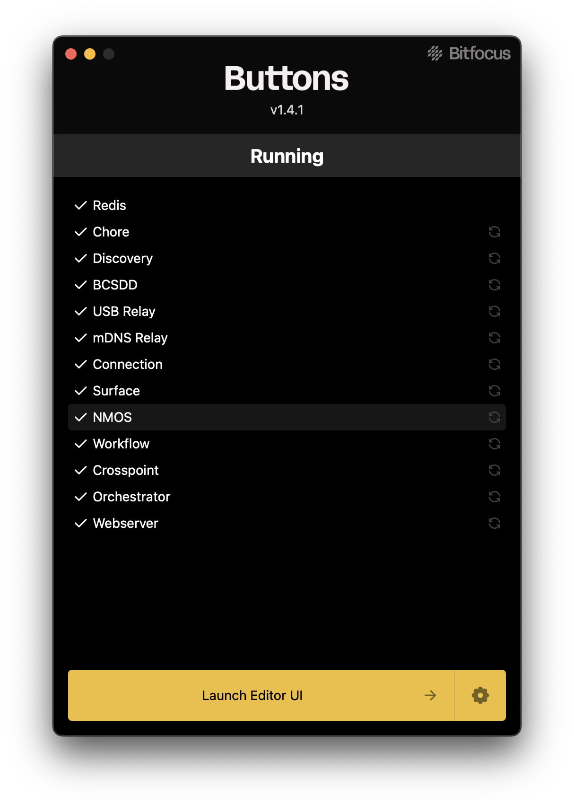

When you start **Buttons**, a window pops up displaying all the running processes. From this window, you can restart any processes that aren't running. You can also open the web interface here, and it's the right place to quit **Buttons** if needed.

### Environment Settings

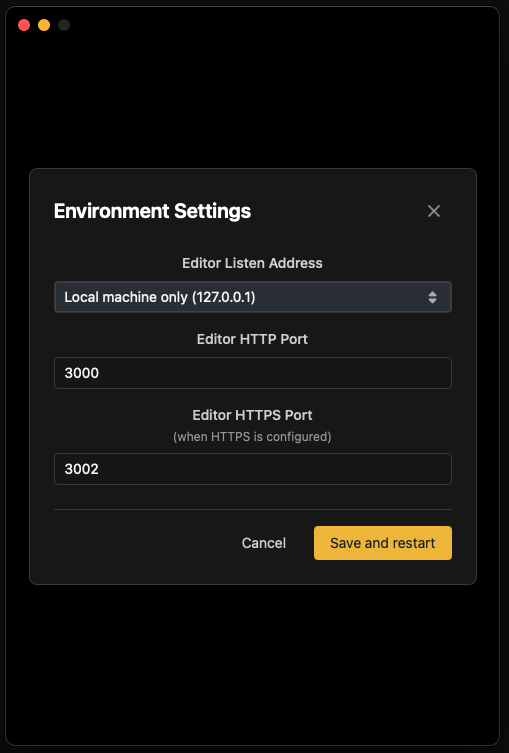

Under the settings cogwheel you will find some environment settings:

- **Editor Listen Address**: Limits on which network the Buttons management UI will be available
- **HTTP Port**: Change the port for HTTP access
- **HTTPS Port**: Change the port for HTTPS access

---

## Licensing

To acquire a license for Buttons, log in to [user.bitfocus.io](https://bfoc.us/i90jvygd91) and navigate to the **Buttons** category. You will be guided through the process of purchasing a subscription for **Buttons**.

### Assigning a License

Once you have obtained the required license, navigate to the **Settings > License** page in the Buttons user interface.

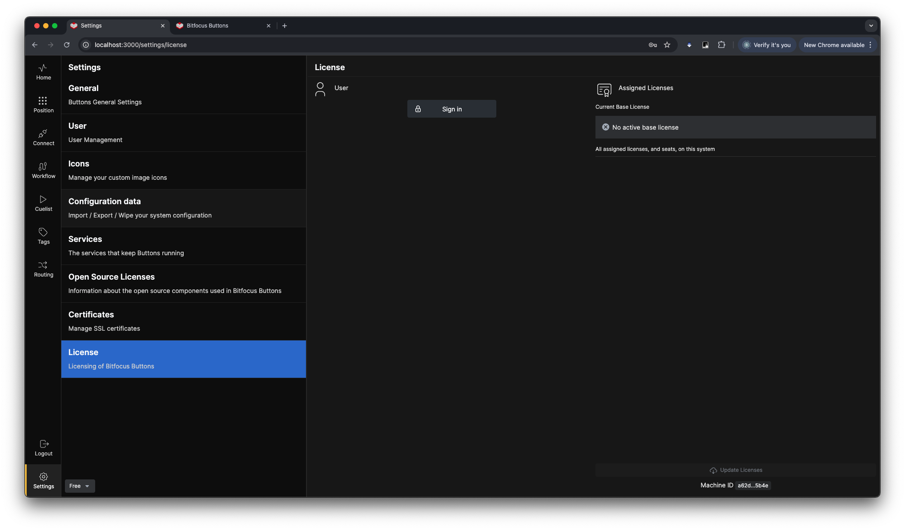

Log in using the same account you used to purchase the license.

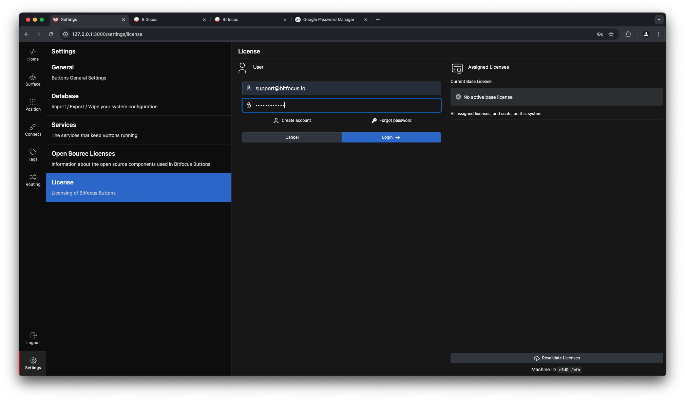

After logging in, a window will display the number of available/total licenses associated with your account.

Click the **+Assign** button to assign a license to the current machine. A dialog box will appear on the left side of the screen. Review the assignment details, and if everything looks correct, click the **Confirm** button in the lower-right corner of the dialog.

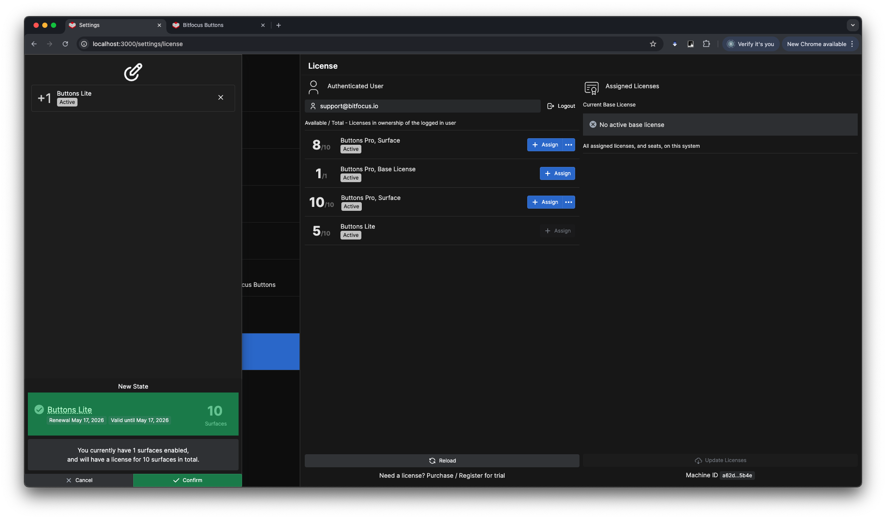

You have now successfully licensed this machine for Buttons.

### Releasing a License

To release a license from a machine, click the **...** button on the right-hand side of the screen and select **Release License**.

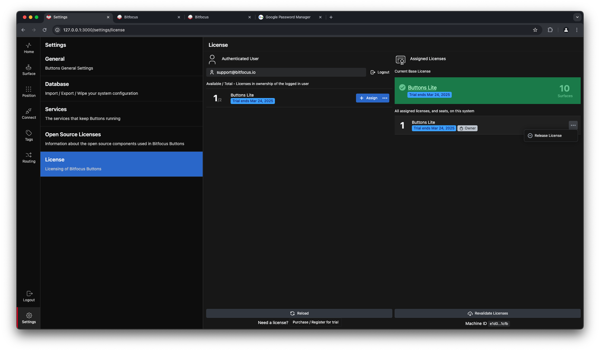

If you have any connected surfaces linked to Buttons, you will not be able to release all licenses. A dialog box will inform you of the actions required before releasing the license.

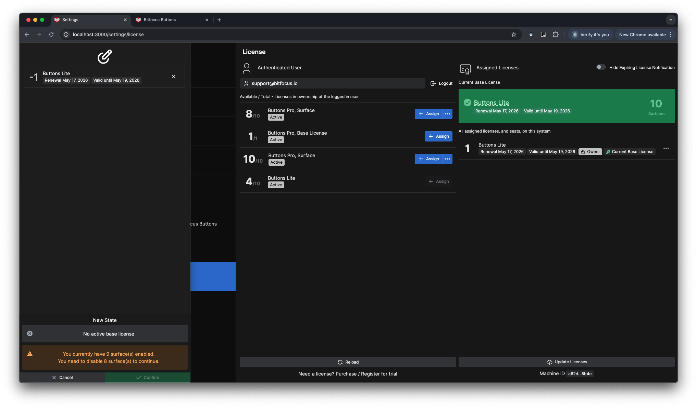

If your remaining licenses cover the connected surfaces, or if you have 1 connected surface, a confirmation dialog will appear. Click the **Confirm** button to release the license from the machine, allowing it to be assigned to another machine.

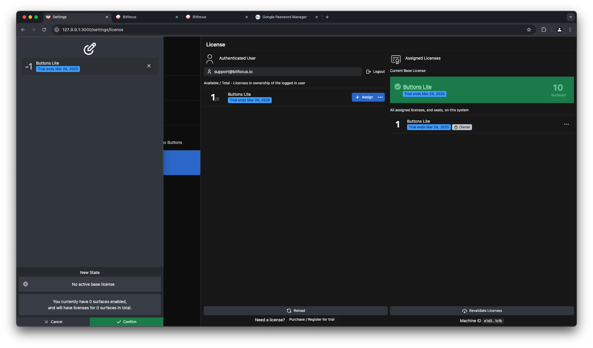

In this example, the number of available licenses is updated to 5/10.

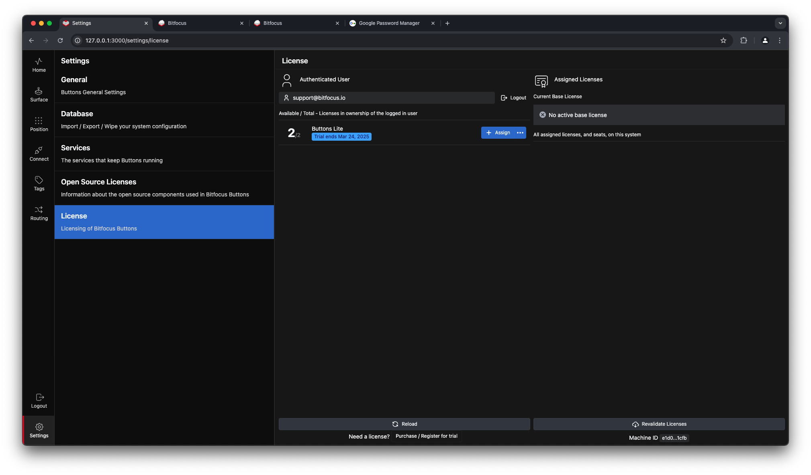

### Recovering a License

If you for any reason happen to see this warning in the lower left of your screen on a machine that you know should have a license:

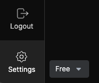

Go to the license page as instructed earlier and log in to the Bitfocus user account that holds the license for that machine, and you will be presented with the option shown below. Just click on the **Recover →** button and your license will be restored on to the machine.

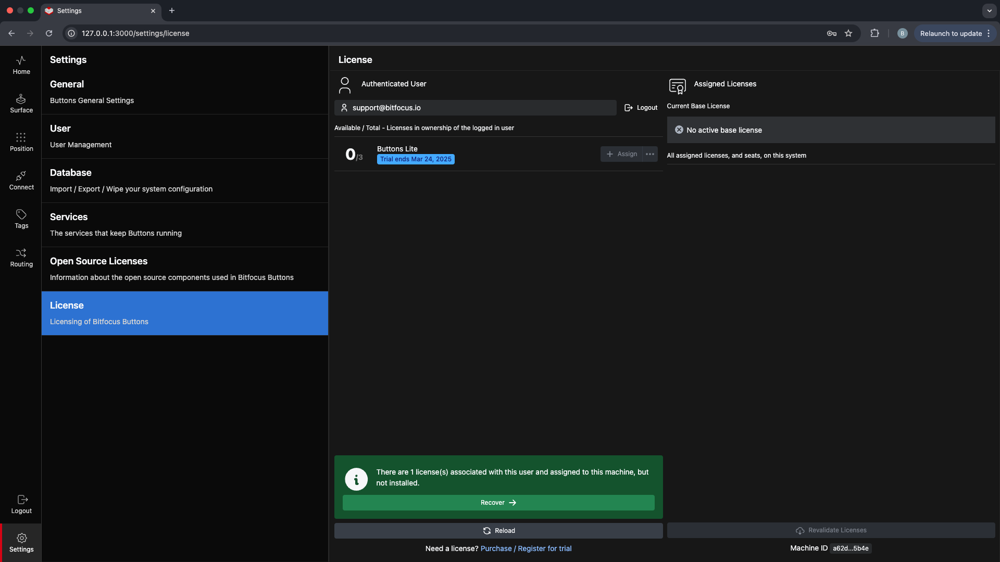

### Lost or Broken Machine

If your machine is broken or lost and a license is still associated with that machine, you can retrieve that license back to your account's license pool by sending an email to [support@bitfocus.io](mailto:support@bitfocus.io). Include information about the **host name** of the machine you want to retrieve the license from, and please send the email from the email account that is associated with the Bitfocus user account, so that we can verify that you have the rights to retrieve the license.

