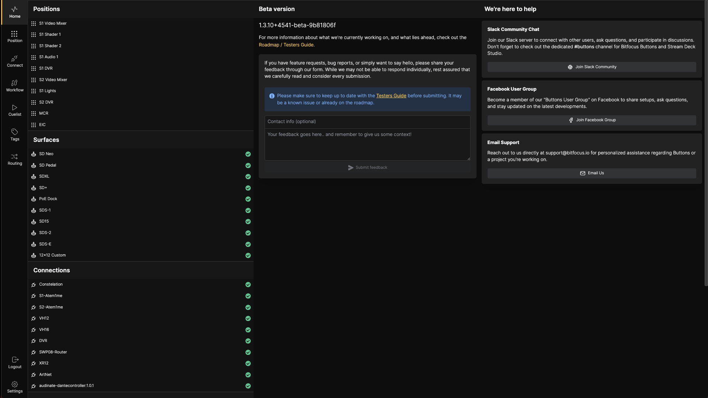

# Interface Overview

## Home Screen

The home screen provides a central dashboard for accessing all features and monitoring system status.

### Menu Bar

On the far left, you have the menu bar with access to all pages in Buttons:

- **Home Screen**: The main dashboard
- **Position Page**: Position configuration
- **Connect**: Connection and surface management
  - **Connections**: Hardware, software, and service configuration
  - **NMOS**: 2110 configuration
  - **Surface**: Control surface connection and configuration
- **Workflow**: Workflow configuration
- **Cuelist**: Cuelist configuration and execution
- **Tags**: Tag configuration for organization
- **Routing**: Routing configuration
  - **Route**: Set up and execute routes, create salvos
  - **Salvo**: Create, execute, and edit salvos
  - **Labels**: Set user labels for the routing system
  - **Config**: Overview of all ports and bundles
- **Log Out**: Log out of the Buttons UI
- **Settings**: System configuration

### Status Panes

The center panes display currently configured and active components with their status:

- **Positions**: All configured positions
- **Surfaces**: Connected control surfaces
- **Connections**: All non-NMOS connections
- **NMOS**: All NMOS connections
- **Workflows**: All configured workflows
- **Cuelist**: All configured cuelists

### Support Information

On the rightmost pane, you'll find version information and support options:

- **Version Information**: Current Buttons version
- **Feedback Box**: Send feedback to Bitfocus (not for support requests)
- **Slack Community**: Chat with developers and users worldwide
- **Facebook Group**: Join the Bitfocus community on Facebook
- **Email**: Contact support@bitfocus.io directly

