# Connections

**Connection** is where we link **Buttons** to the outside world: switchers, routers, software, hardware, and other imaginable (and unimaginable) options.

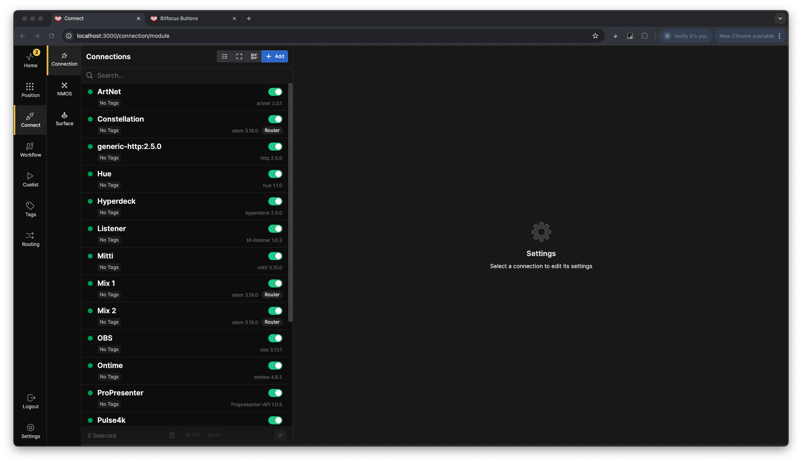

## Adding Connections

To start adding a connection, click the **+Add** button in the top-right corner of the left pane. This will display an extensive list of possible connections.

If no connections are visible, or you can't find the right module, you may need to update the library. Click *Download modules* in the top-right corner.

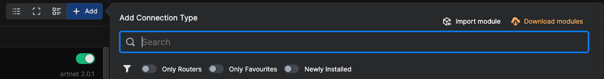

This will bring up a popup box showing you the modules that are missing from your library or have newer versions.

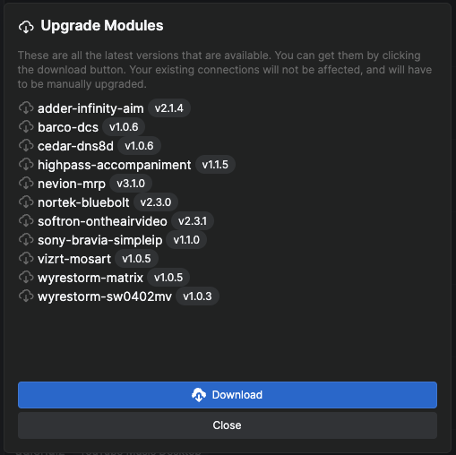

Ensure you are online, as this process fetches the library from Bitfocus's servers. The download duration depends on your connection speed and the number of modules that will be downloaded.

Once the download is complete, you can search for the desired connection. Search by manufacturer, product line, or protocol. Generic connections can also be found by searching for the "generic" phrase.

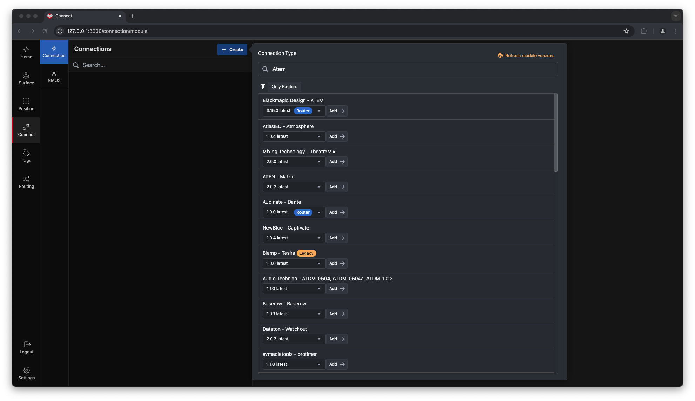

---

## Connection Badges

Each connection comes with a version dropdown and several informational badges.

### Router Badge

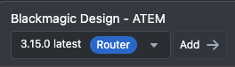

Indicates that the connection is supported by the Router system in Buttons. To filter the connections list for Router-supported options, click *Only Routers* at the top of the list.

### Legacy Badge

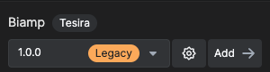

Indicates that the connection does not adhere to the latest API standards. While it may work, some features might be unavailable or non-functional.

### Pre-release Badge

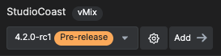

Indicates that the developer has released a test version of the module, and it may lack functionality or contain bugs.

---

## Version Management

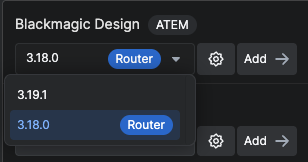

The **Version Dropdown** allows you to select between different versions of the connection as the library evolves.

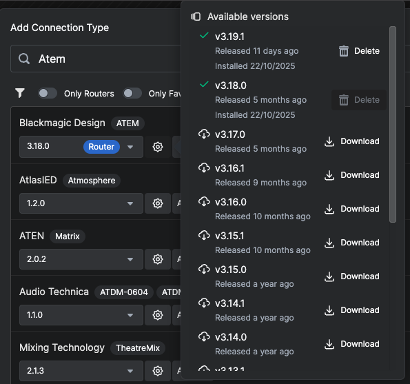

You can also click the cogwheel to see and download other versions of the module.

---

## Configuring Connections

In the right pane of the connection page, you'll find all configuration options for the selected connection.

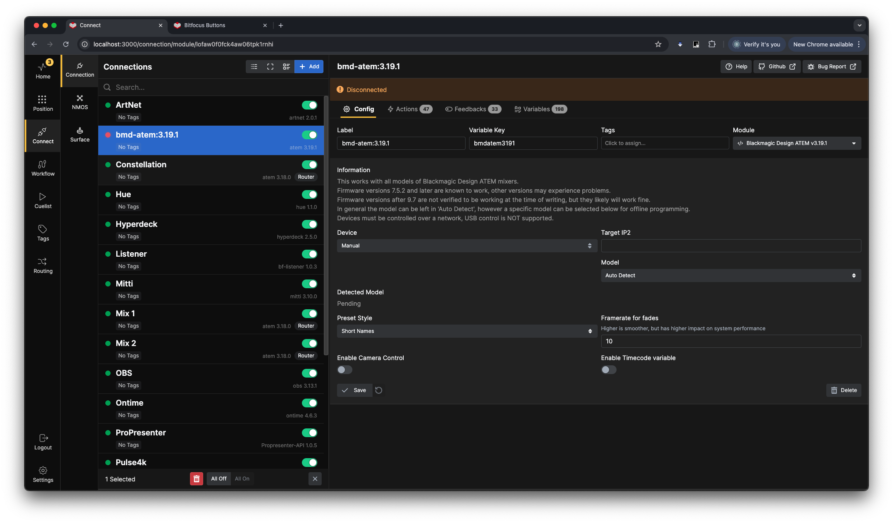

Some connections support MDNS to automatically discover devices, but it's good practice to know the connection settings beforehand. You can also enter the IP address for the connection manually. It's good practice to give each connection a clear and descriptive **Label** and **Variable Key**, so it's easy to recognize at a later stage.

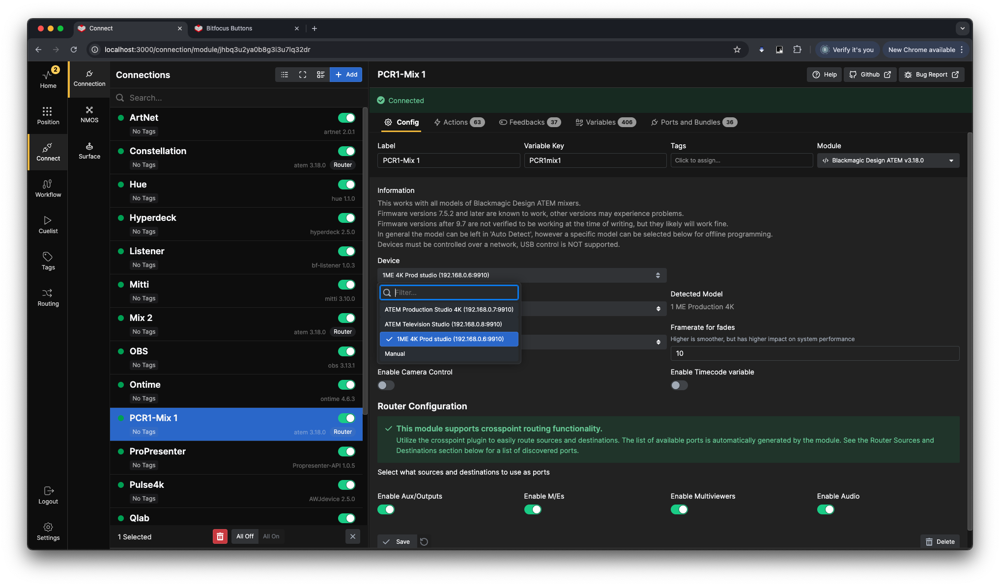

### Swapping Module Versions

Under **Module** in the top right corner you can see the current module version in use for this connection. Clicking on it brings up a dialog box allowing you to swap the module versions.

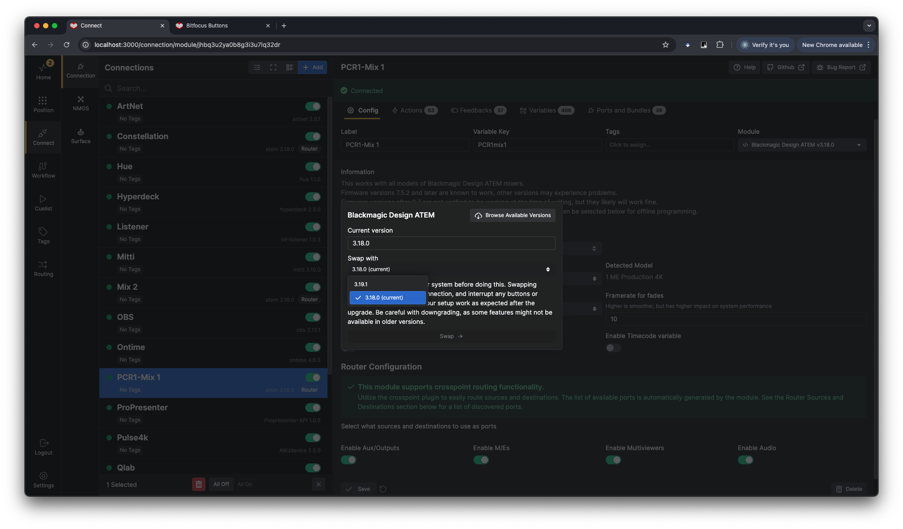

---

## Connection Overview Tabs

### Actions Overview

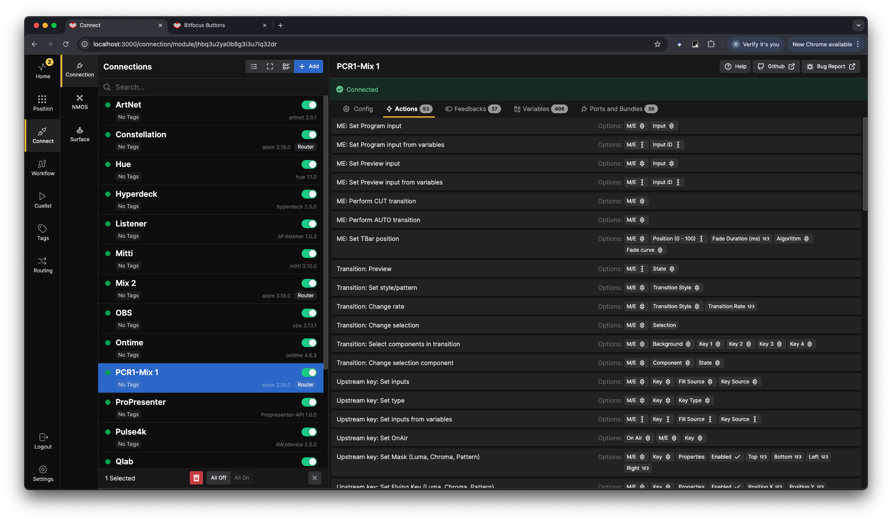

View all available actions in the connection.

### Feedbacks Overview

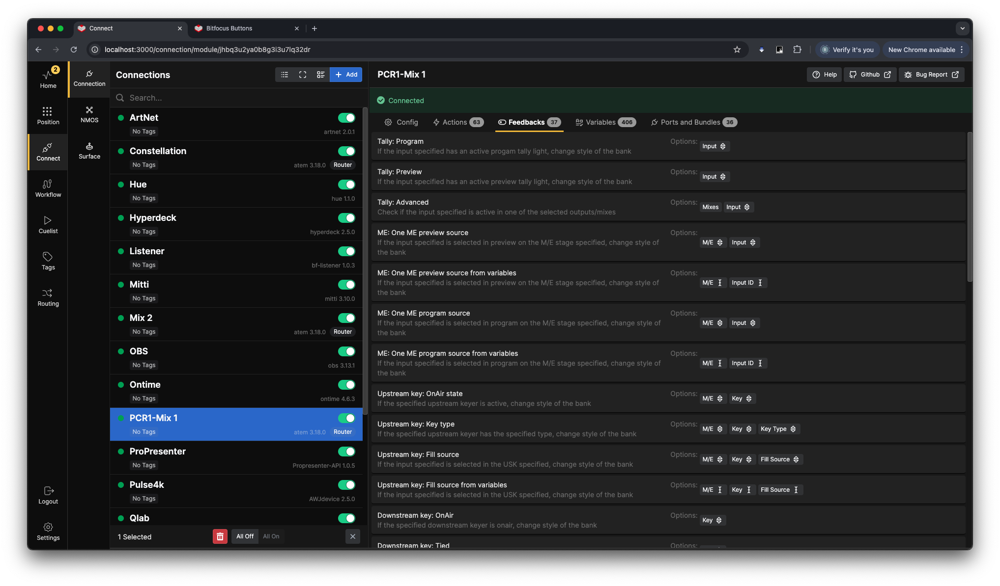

View all available feedbacks.

### Variables Overview

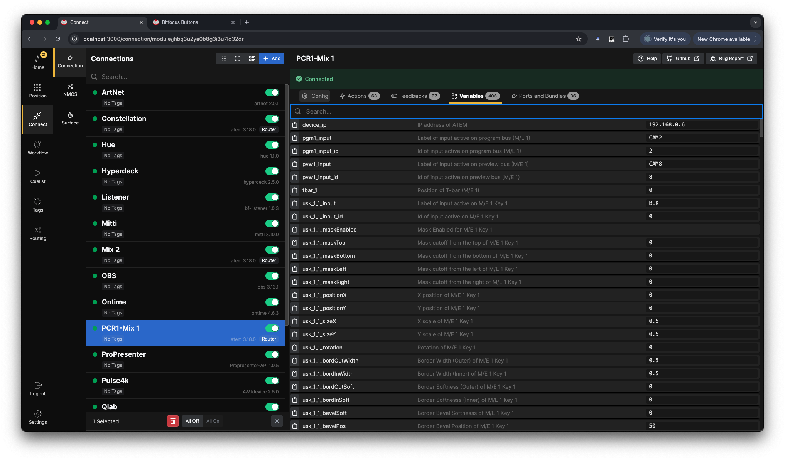

View all variables exposed by the connection.

### Ports & Bundles Overview

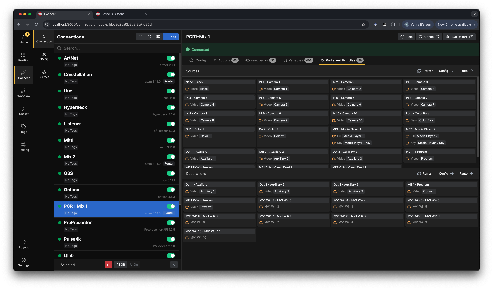

See what will be added to the Router system in Buttons.

---

## Module Information

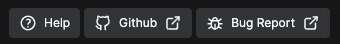

These buttons allow you to:
- Navigate to GitHub to post a bug report
- Navigate to the repository
- Open the help file written by the module author

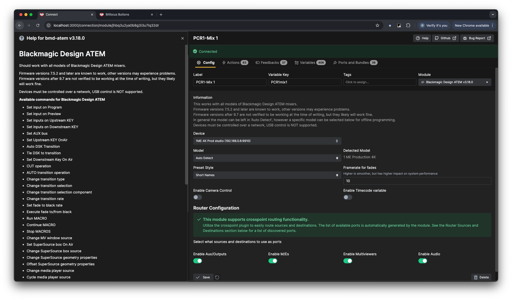

---

## View Options

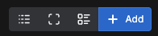

- **Log View**: Turn on debugging for the connection
- **Compact/Detailed View**: Toggle between views
- **Group/Sort**: Group and sort connections by tags

### Log View

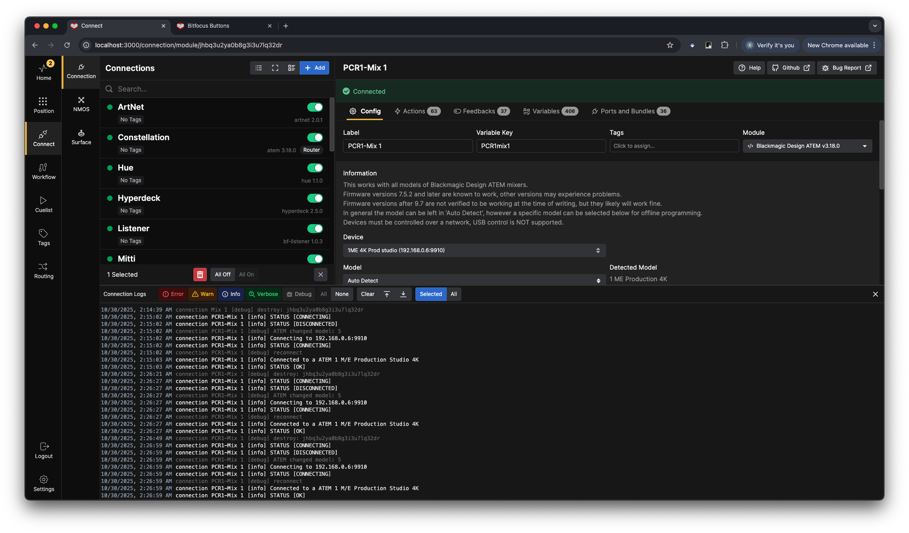

### Compact and Detailed Views

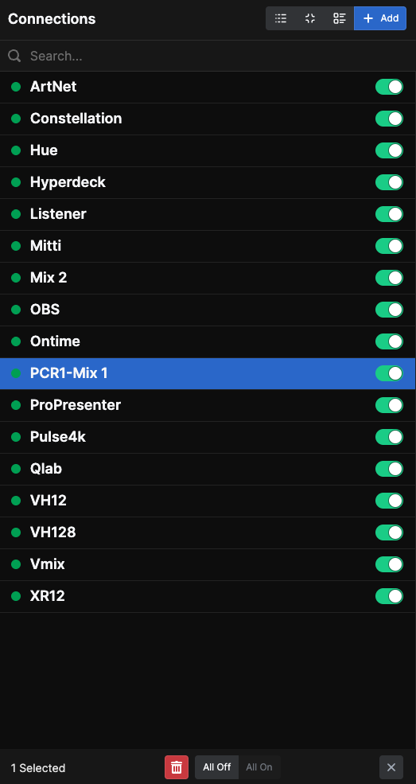 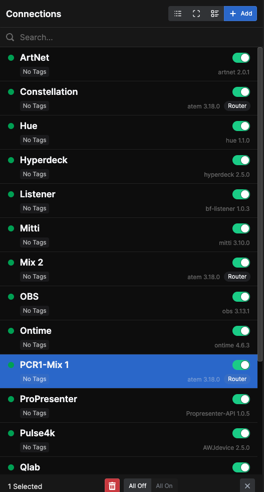

### Grouping Options

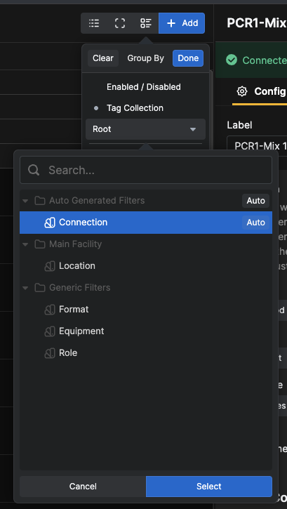

---

## NMOS Connections

Under the **NMOS** section in the left pane of the connection page, you can find and set up NMOS devices available on your network.

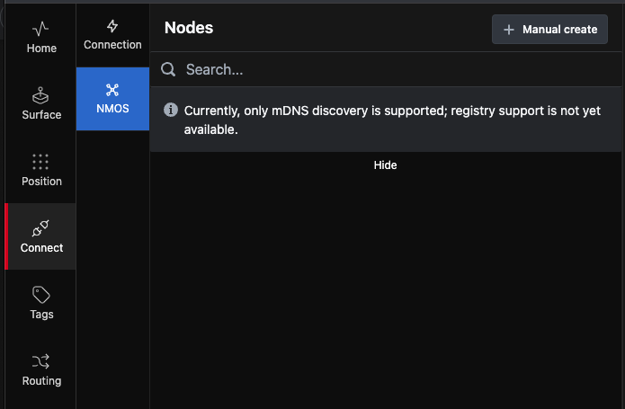

If NMOS devices on your network announce themselves, they will appear and be available to connect to Buttons.

### Manual NMOS Creation

If devices are on another network segment or fail to appear, you can manually create the connection by clicking the **+Manual create** button. You'll need the IP address and port of the device.

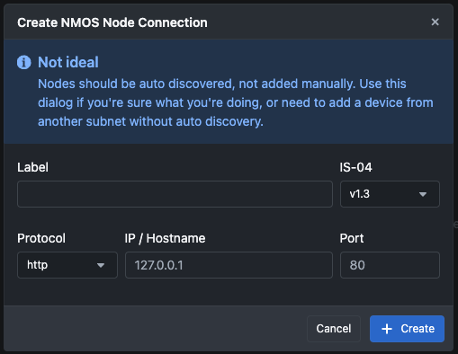

Provide a name, IP address, and port number. For instance, a Blackmagic Design 2110 IP Video Converter 3x3G with IP `10.141.20.1` and port `8090`.

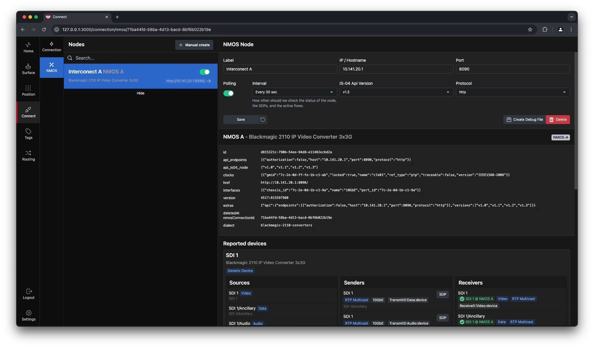

The NMOS connection is now ready for use in Buttons and will be available in the **Router Section** and on the **Routing Page**.

