# Surfaces

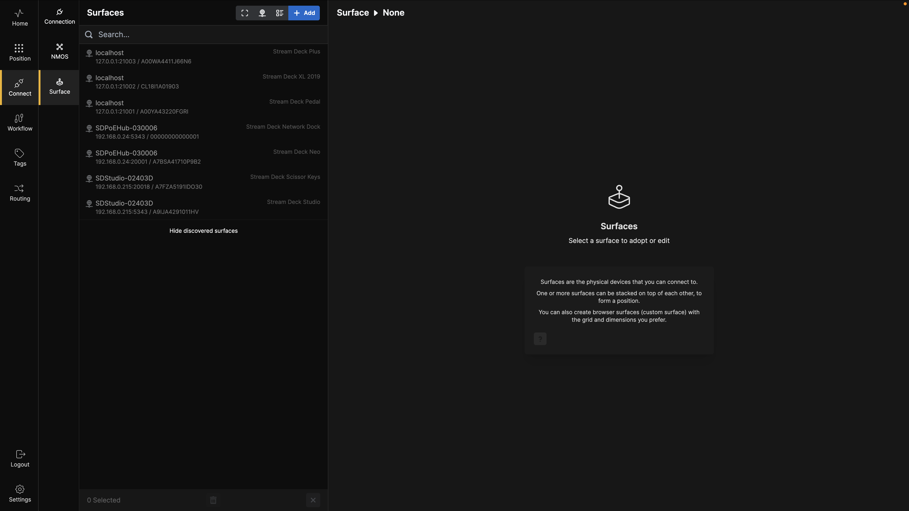

When you click on **Connect** and then **Surface** in the menu bar, the window shown above opens. Initially, this window displays the surfaces available on the network you are connected to. It provides details about the surface type, IP address, port number, and serial number.

---

## Surface Discovery and Adoption

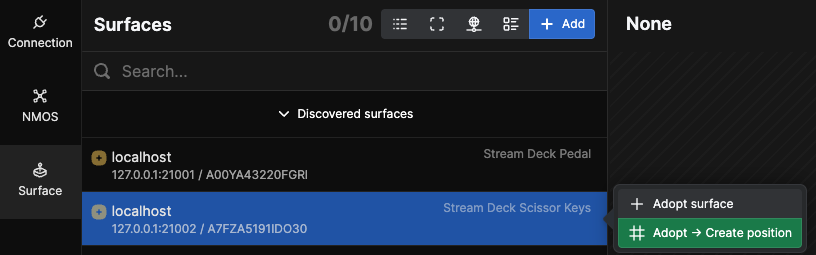

If you click on one of the surfaces, the context menu shown above will appear. Click on **Adopt** to add the surface to Buttons.

> **Note:** The small **+** badge in front of a surface indicates it has been newly discovered on the network.

### Adopting Multiple Surfaces

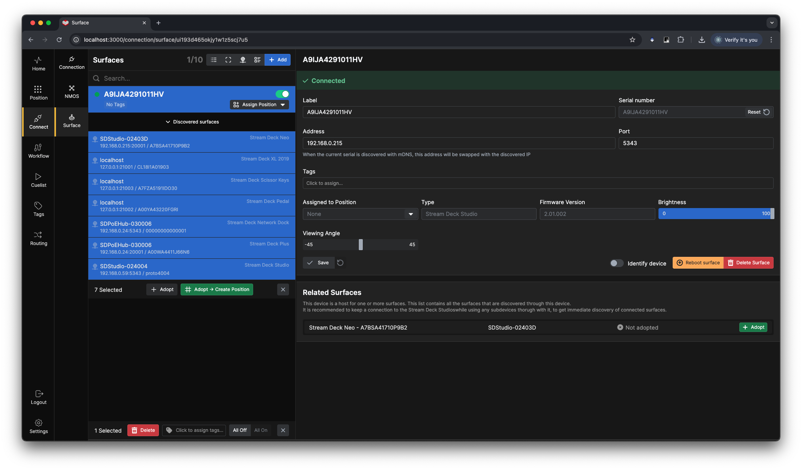

You can adopt multiple surfaces at the same time by selecting them together.

---

## Surface Configuration

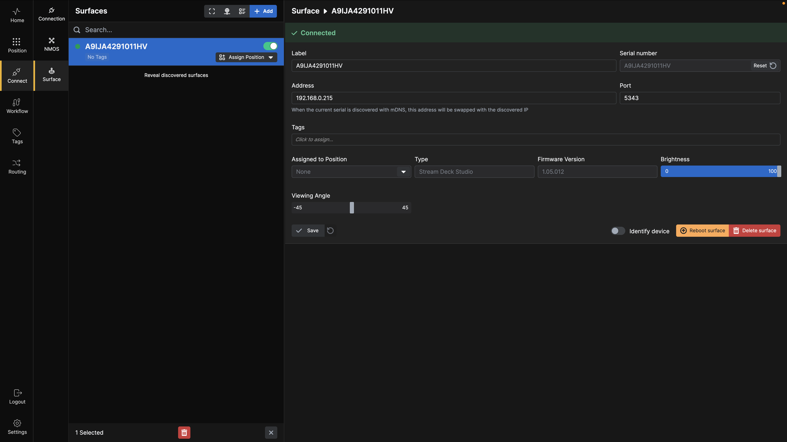

Clicking **Adopt** adds the surface to **Buttons**. Click it again to open the **Surface Config** settings. Here, you can:

- Change the label of the surface
- Reset the serial number of the Stream Deck
- Change the IP and port of the surface
- Add tags
- Assign or remove the surface from a position
- Check type of surface and firmware version
- Adjust the panel brightness
- Reboot the surface
- Use the **Identify** function to flash a button on the physical surface, making it easier to locate
- Adjust the viewing angle of the Stream Deck Studio
- See related surfaces (e.g., Stream Deck Neo connected to front USB of Stream Deck Studio)
- Delete surfaces you no longer want to control

Remember to click **Save** when you are done.

---

## Position Assignment

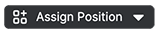

The dropdown button shows that the device is adopted into **Buttons**, but is not currently assigned to any **Position**.

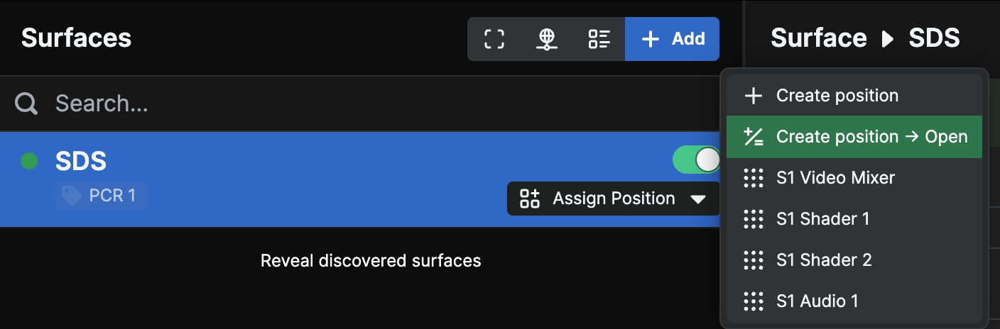

If you click on the indicator, a context menu appears where you can either:
- **Create Position**: Create a new position for this surface
- **Assign to Existing Position**: Choose from configured positions

---

## View Options

At the top of the window there are several buttons:

- **License Count** (8/10): Shows currently active surfaces vs. license limit
- **Log View**: Turn on to debug connection issues
- **Minimize/Maximize**: Toggle information detail level
- **IP Display**: Show or hide IP addresses
- **Grouping**: Group surfaces by tags for easier organization

### Grouped Surfaces

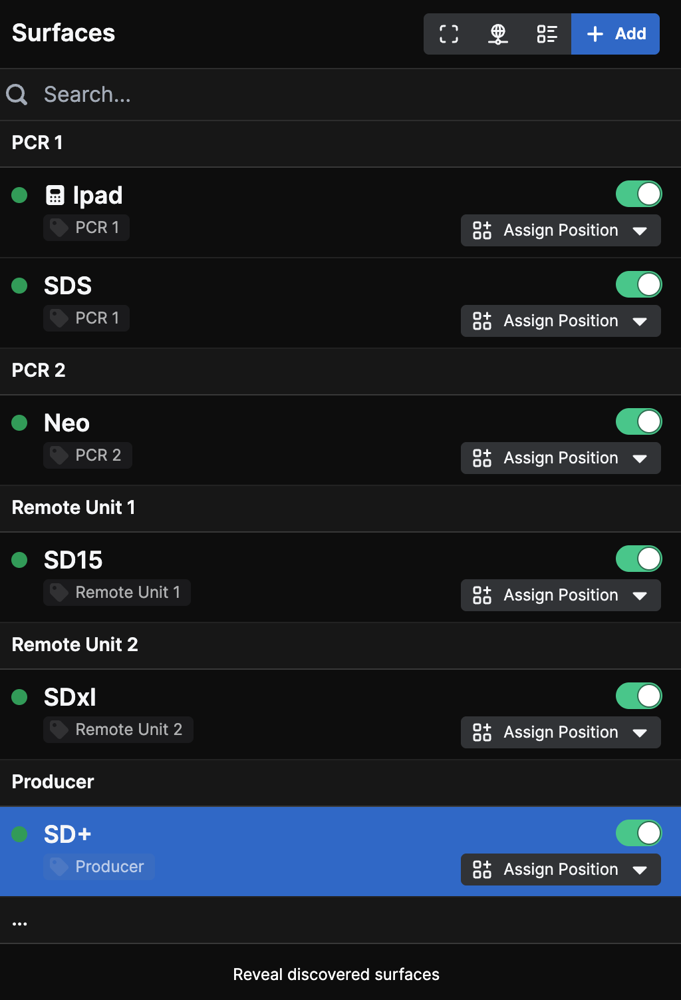

---

## Creating Surfaces Manually

You can also click on the blue **+Add** button to manually set up a surface.

### iPad Surface

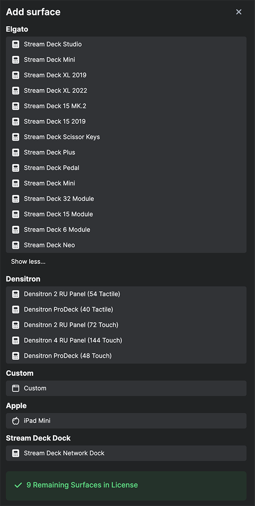

This opens the **Create Surface** selection dialog box. Select the surface type you want to create.

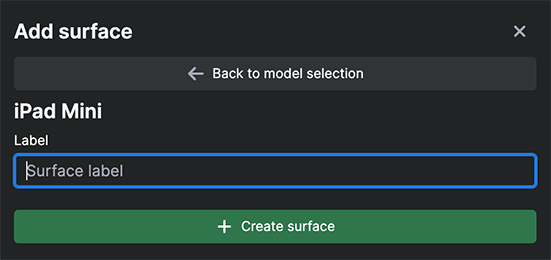

Give it a name and click **Create Surface**.

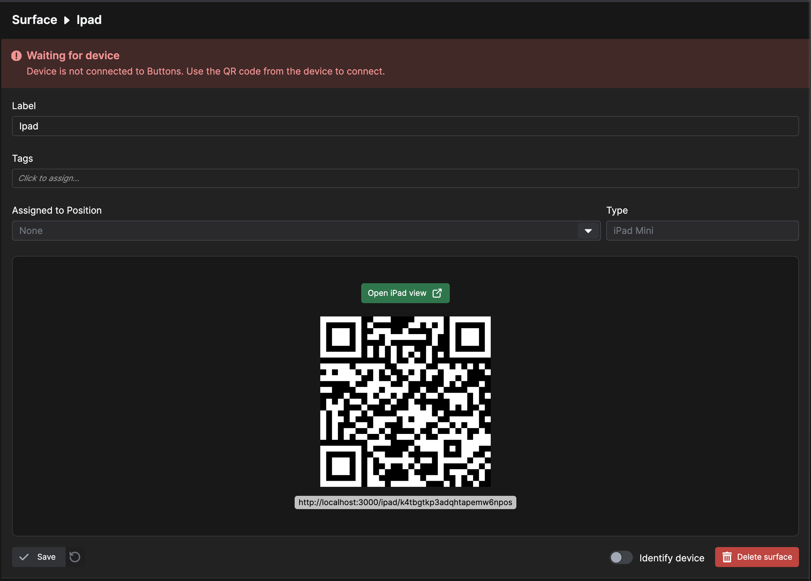

This brings up the **Surface Config** page for the iPad surface you just created. To view it, click the green **Open** button.

This will open an iPad view in your browser, which can be used as a surface.

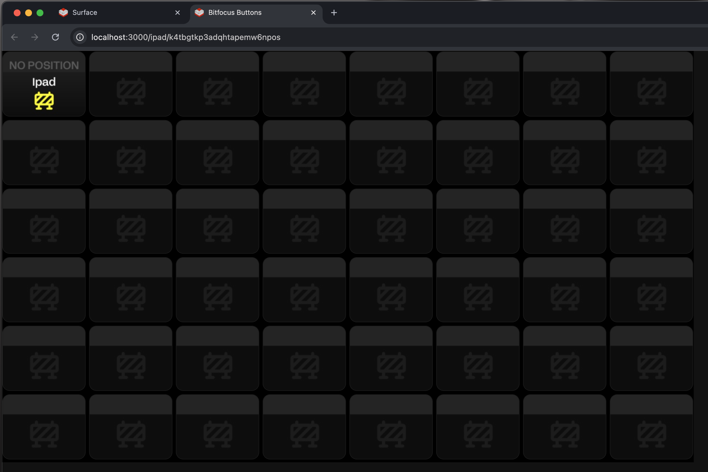

To bring this view to an actual iPad, replace the `localhost` with the IP address of the machine running **Buttons**. For example:

`http://192.168.0.252:3000/ipad/k4tbgtkp3adqhtapemw6npos`

In this case:
- `192.168.0.252` is the IP address of the machine
- The final part of the URL (`k4tbgtkp3adqhtapemw6npos`) is the unique ID of the surface

These values will differ in your setup based on your IP address and surface configuration.

---

## Custom Browser Surfaces

You can also add a custom surface which will turn any touch-screen with a compatible browser into a Buttons surface.

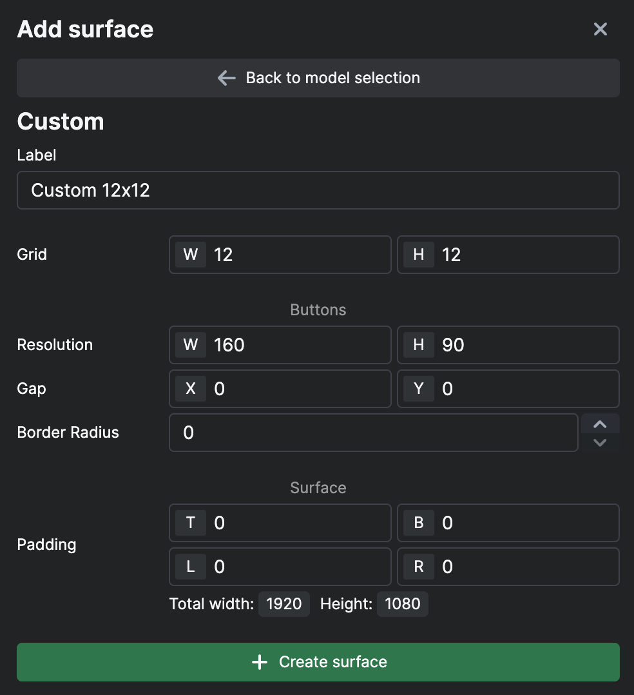

Notice that the config gives you the resolution at the bottom so that you can experiment with the different values to perfectly fit the intended surface.

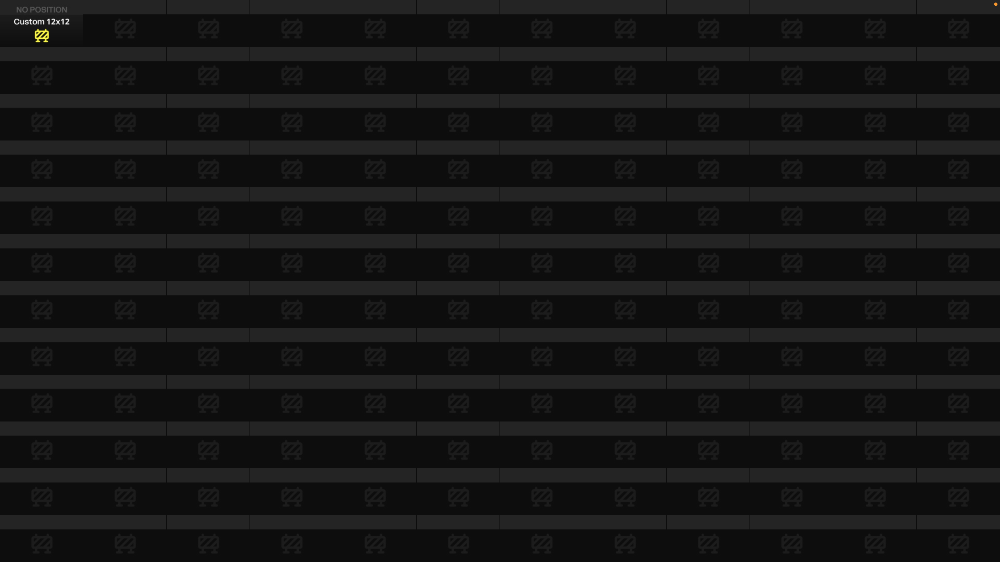

The way to connect a custom surface to the Buttons setup is the same as for an iPad. You can also edit the setup after it's created in the config window.

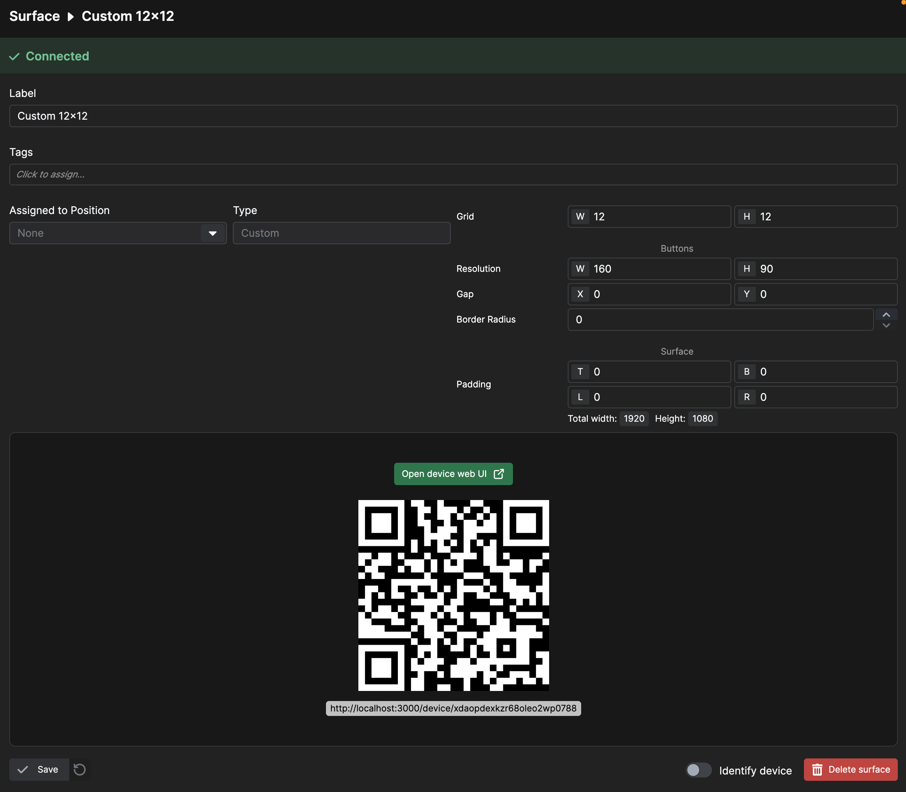

