# Positions

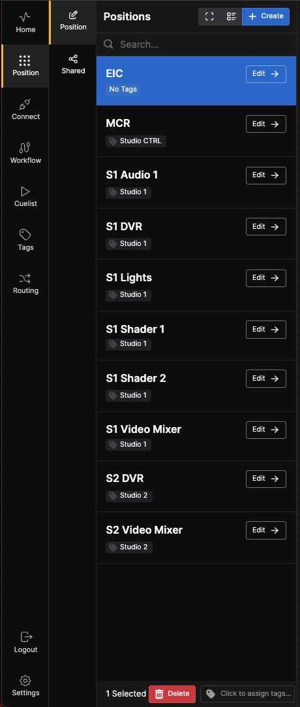

A **Position** defines a collection of one or more **Surfaces**. It typically aligns with the working role of an individual, such as Vision Mixer, Graphics, or Shader. Each **Position** can be tagged for better organization.

## Creating a Position

To create a new **Position**, click the **+Create** button at the top of the left pane.

A dialog box will appear, prompting you to enter a label for the **Position**. It's a good idea to plan your naming conventions beforehand to maintain a logical and consistent system.

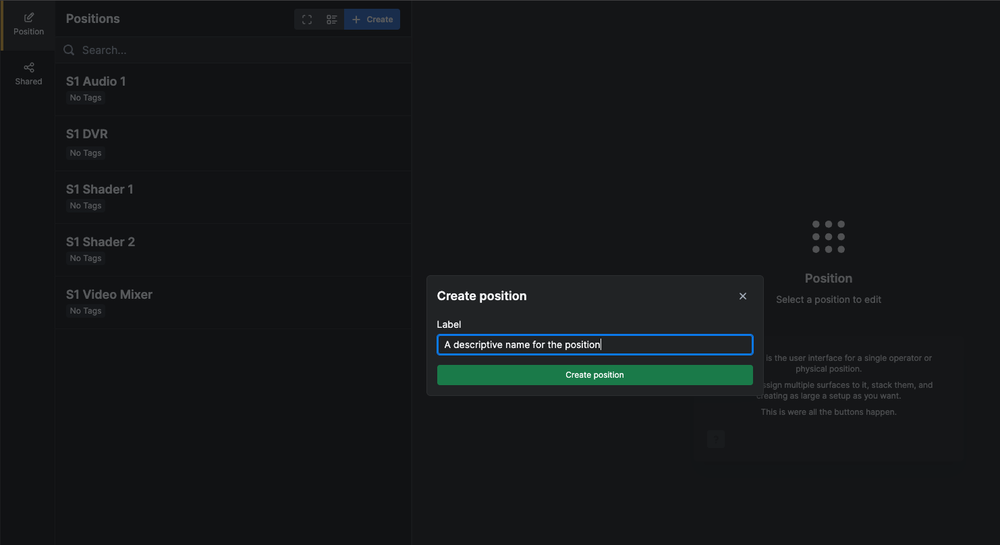

Click **Create Position**, and the **Position Editor** window will open.

> **Tip:** You can also create positions when configuring your surfaces.

---

## Position Editor

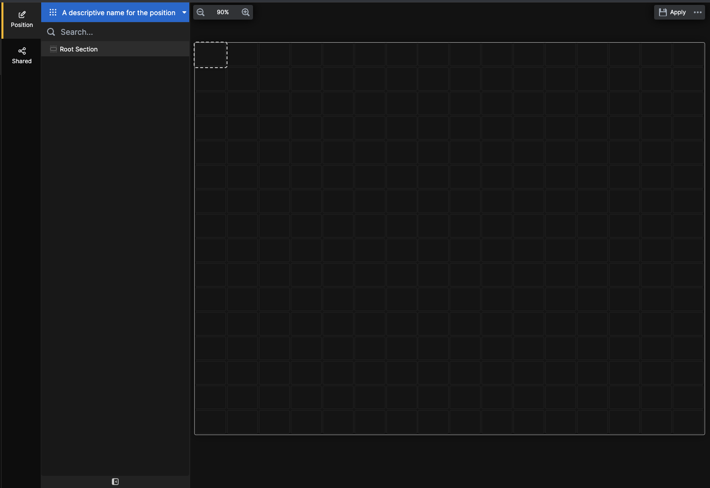

The **Position Editor** window consists of three panes:

- **Left Pane**: Navigation tree
- **Middle Pane**: A 16×16 grid called the **Canvas**
- **Right Pane**: Contains **Inspector**, **Presets**, and **Configuration** tabs

### Minimizing the Navigation

To gain more space for editing, you can minimize the left pane.

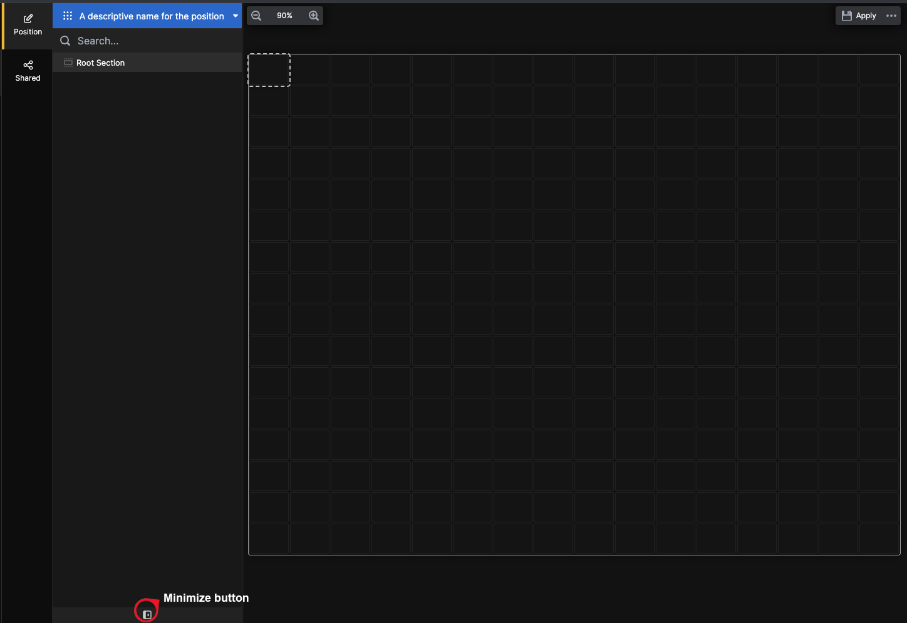

### Pane Positioning

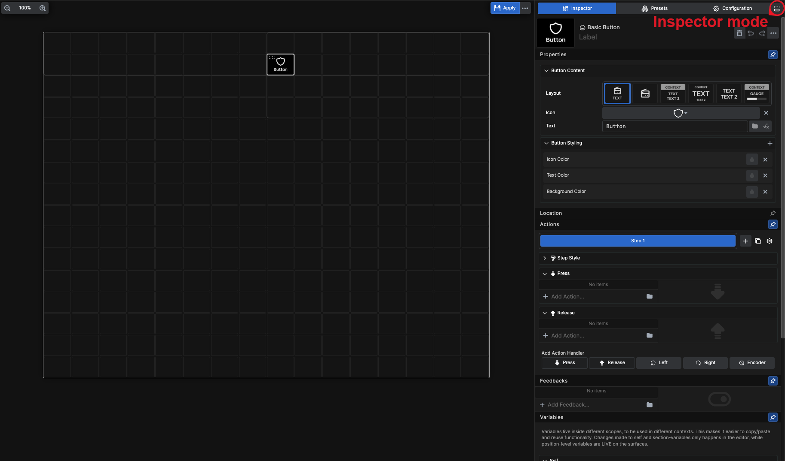

To optimize your workspace, you can move the **Inspector** pane from the side pane to the bottom of the screen. This setting provides more real estate for making multiple edits without excessive navigation.

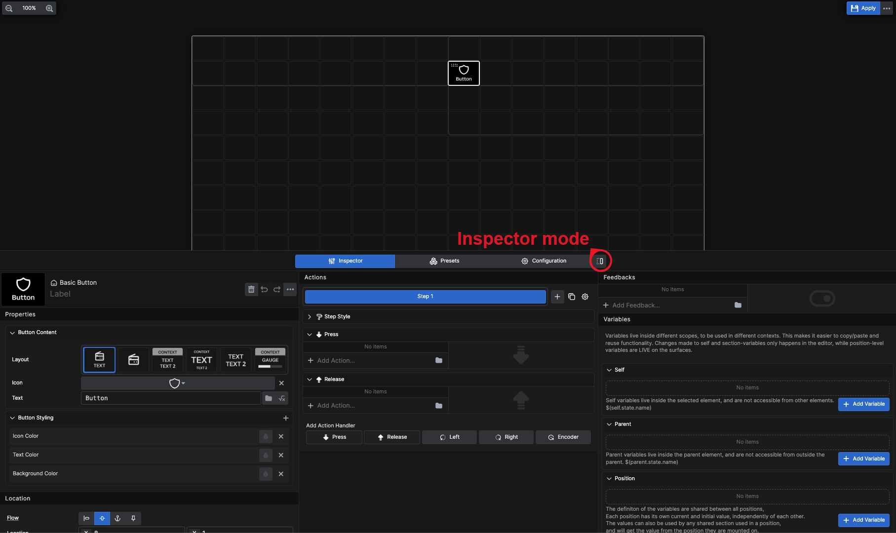

---

## Configuration View

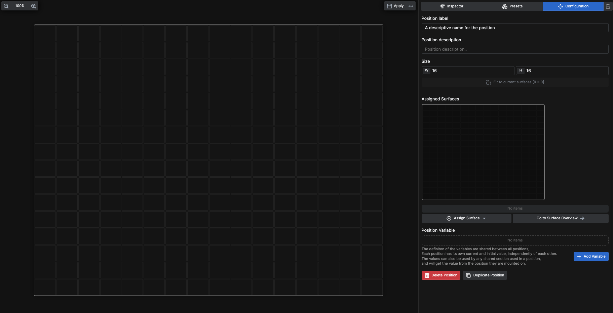

Here, you can change the name, add a description for the **Position**, and assign **Surfaces** to it.

### Assigning Surfaces

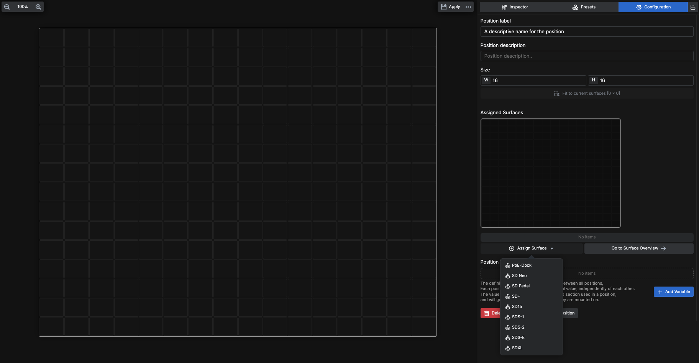

Click **Assign Surface** and select the desired surface.

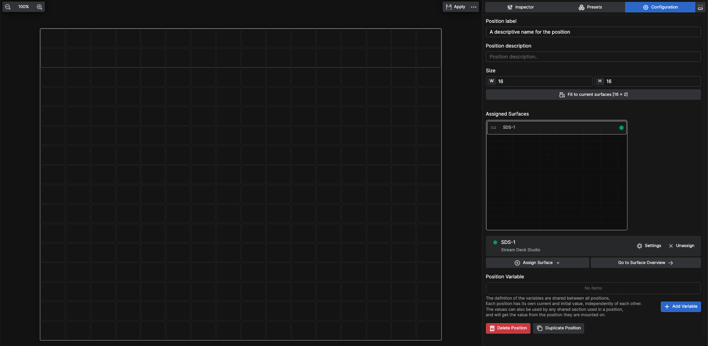

The selected surface will appear in the **Canvas** in the **Configuration** tab. A corresponding outline will also display in the center pane **Canvas**, showing the part of the canvas covered by the surface.

### Multiple Surfaces

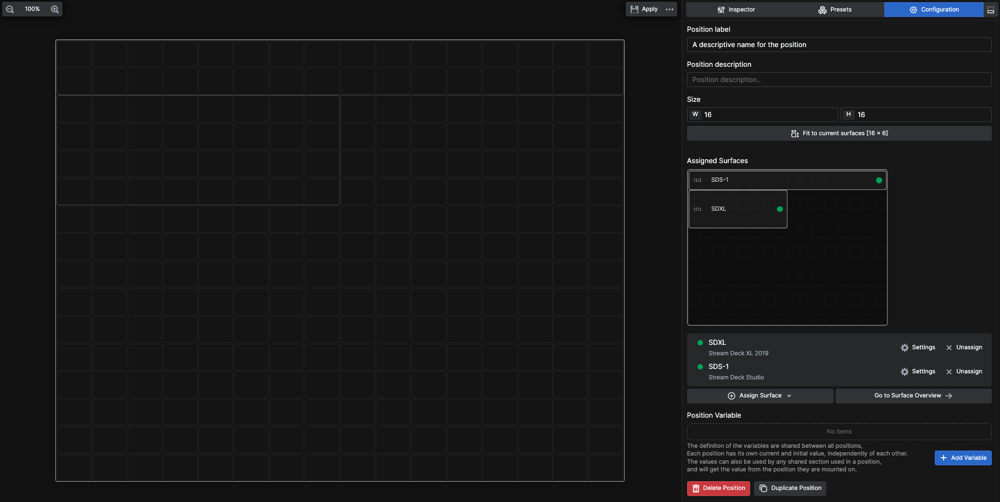

You can assign multiple surfaces to a position. The outlines correspond to the button layouts of the assigned surfaces:

- **STREAM DECK STUDIO**: Two rows of 16 buttons
- **STREAM DECK XL**: Four rows of 8 buttons

You can combine surfaces freely within the same canvas.

### Moving Surfaces

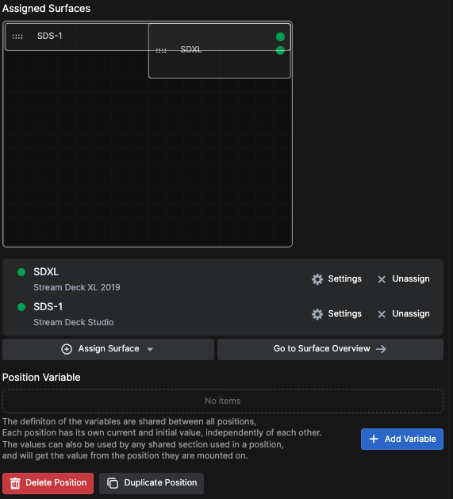

Move surfaces around from the **Configuration** window by clicking on a surface and dragging it to a new position. Overlapping parts of surfaces will display shared buttons on both.

---

## Position Variables

Position variables allow you to assign variables to your positions.

The definition of the variables are shared between all positions, while each position has its own current and initial value, independently of each other. The values can also be used by any shared section used in a position, and will get the value from the position they are mounted on.

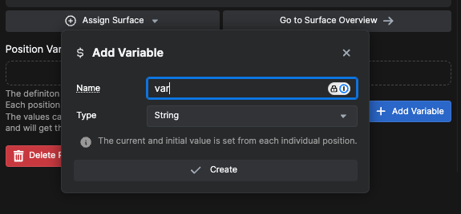

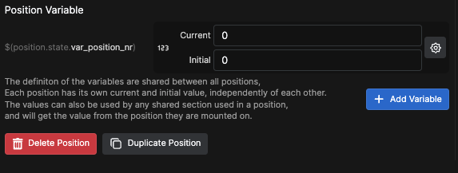

---

## Canvas Interactions

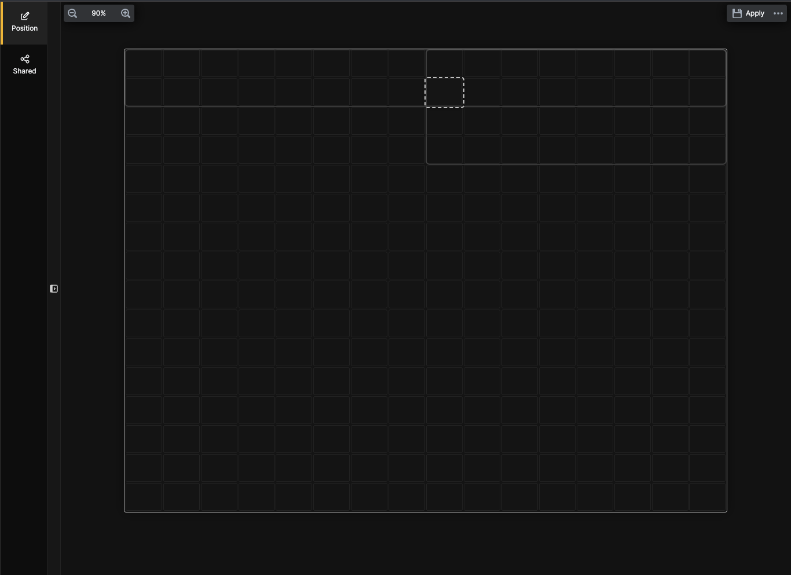

Click inside any rectangle on the **Canvas**; its outline will become dashed, indicating it's selected.

### Context Menu

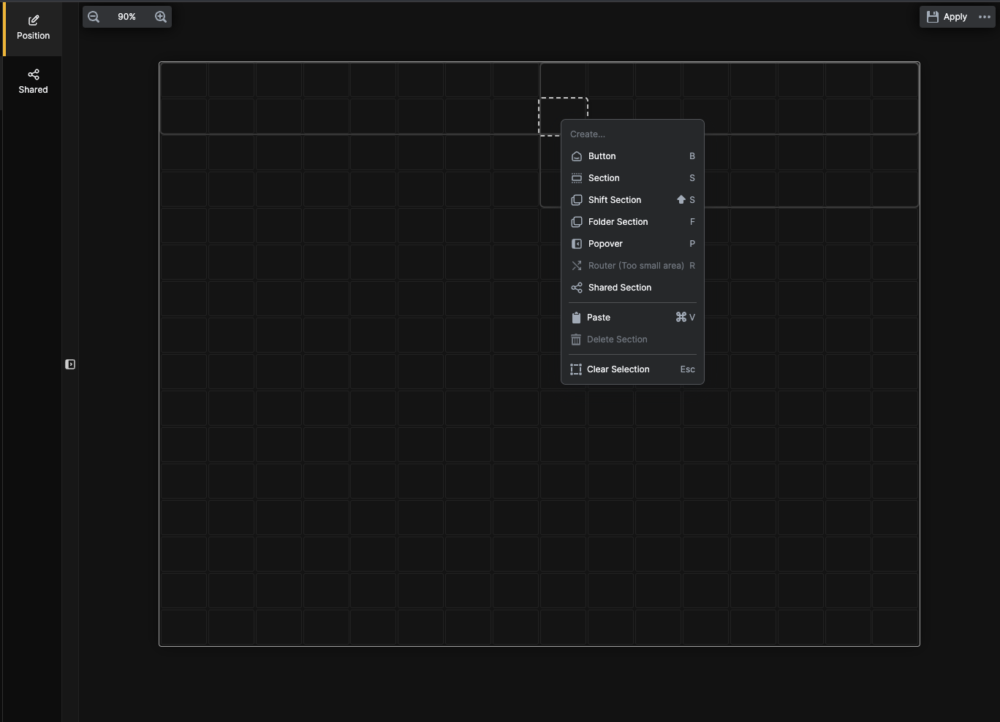

**Right-click** to open the context menu. From here, you can create:

- **Button** (shortcut: **B**)
- **Section** (shortcut: **S**)
- **Shift Section** (shortcut: **Shift+S**)
- **Folder Section** (shortcut: **F**)
- **Popover**
- **Router** (shortcut: **R**)
- **Shared Section**

The **Paste** and **Clear Selection** options are also available.

### Creating a Button

Click on **Button** or press **B** to create a button.

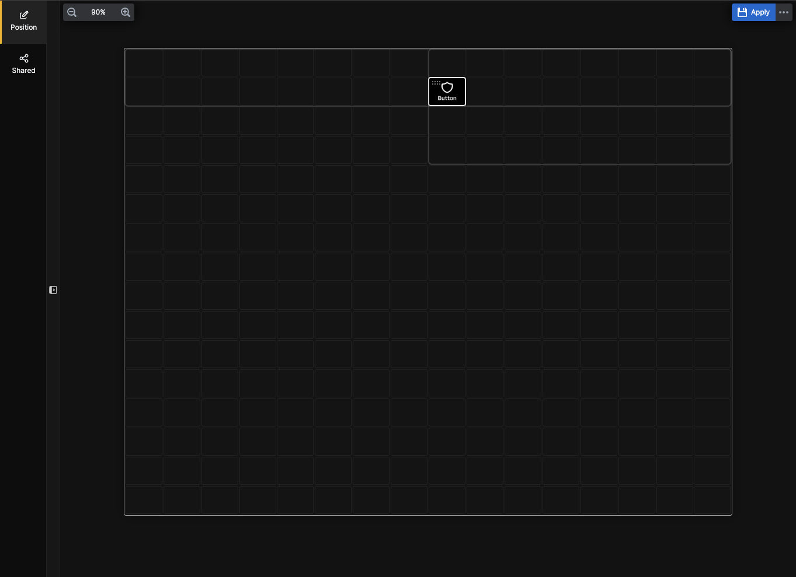

You have now created a **Button**.

