# Buttons

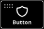

A **Button** is a fundamental action handler. You push it, and something happens. It has many properties, which we will explore step by step.

## Handle Bar

The first thing to notice is the *8 dots* in the top-left corner of a selected button. This is the **Handle Bar**. When you hover over it, your mouse will change to an open hand, allowing you to click and drag the button around the **Canvas**.

---

## Button Properties

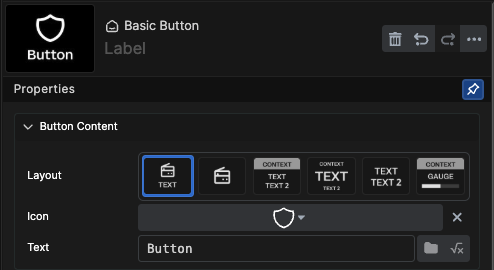

### Label

The name of the button displayed in the tree view.

### Style

Determines the layout of the button:

- Icon and one line of text (Default)
- Icon only
- Three lines of text where the top line has distinct color properties
- Three lines of text where the middle line is larger than the others
- Two lines of text
- Two lines of text, two icons, and two gauge bars

### Icon

Select an icon from a dropdown or use the search bar.

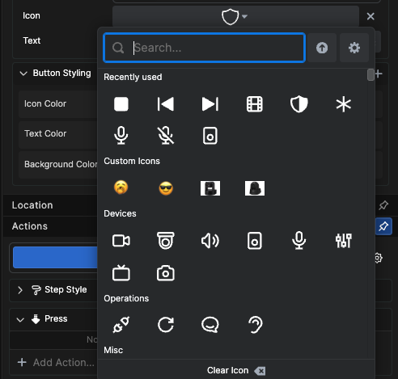

#### Uploading Custom Icons

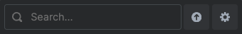

The up arrow after the search box lets you browse for PNG files to be used as custom icons. The settings cogwheel will bring up the custom icon library.

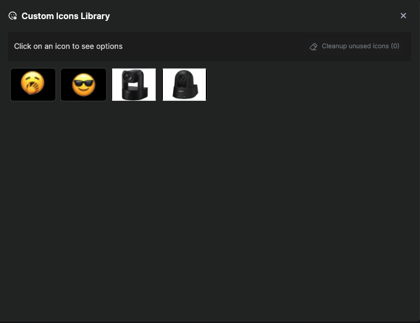

---

## Text Fields

Text fields depend on the chosen button style:

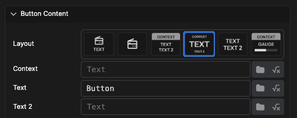

- **Context**: The top line in the third and fourth styles
- **Text**: The middle line in the third and fourth styles (or the only line in the first style)
- **Text 2**: The bottom line in the third and fourth styles

### Variable Selector

Each text box includes a **Variable Selector** button, which opens a dialog for browsing and selecting available system variables.

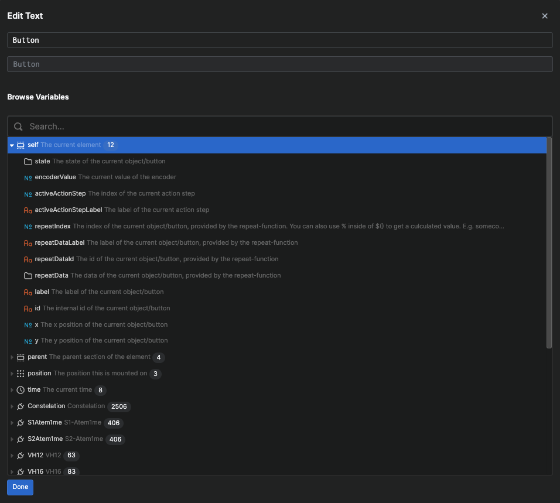

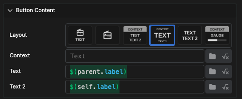

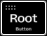

### Expression Mode

The text fields in Buttons also have an Expression mode, which lets you build expressions based on variables, math, and functions. There is a built-in expression builder which will present suggestions as you type out the expression.

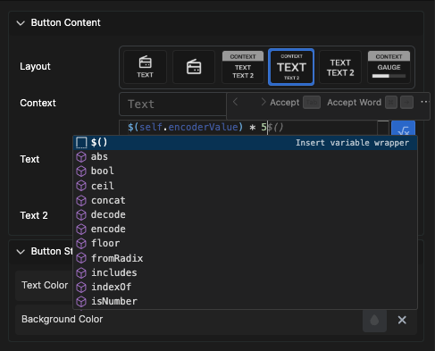

---

## Styling

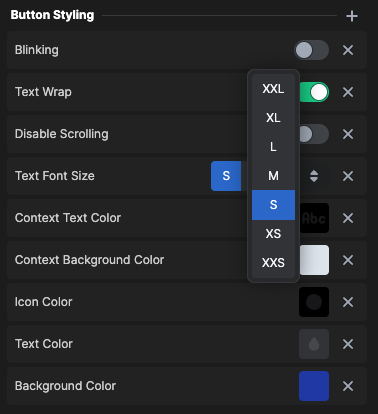

Under styling, you can adjust various options for the button:

- Color
- Font size
- Text wrap
- Text scroll
- Blink

If any option is missing, click on the **+** sign at the top of the styling section and add the option you would like.

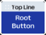

---

## Location

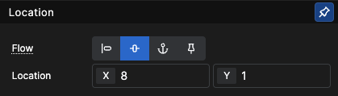

**Flow** determines button behavior and positioning:

- **Float**: Positions dynamically, starting from top-left
- **Static**: Allows full customization by setting X/Y coordinates (Default)
- **Anchor**: Automatically positions the button in corners, allowing resizing
- **Fixed**: Similar to anchor but unaffected by scrolling

---

## Testing Buttons

Test buttons without a surface by holding **Shift** and clicking.

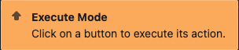

You can also execute actions directly within the action dialog:

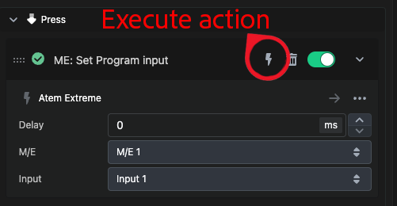

