# Actions and Feedbacks

Actions connect buttons to connections or internal functions. This document covers action handlers, action steps, action groups, action logic, feedbacks, and repeaters.

---

## Action Handlers

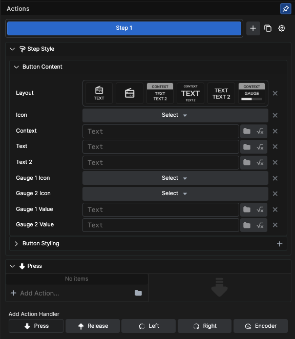

Action handlers determine when actions execute:

- **Press**: Executes when the button is pressed
- **Release**: Executes when the button is released
- **Left**: Assigns an action to left rotation (Stream Deck Studio/Plus)
- **Right**: Assigns an action to right rotation (Stream Deck Studio/Plus)
- **Encoder**: Assigns both left and right rotations to a single action using delta values (Stream Deck Studio/Plus)

---

## Adding Actions

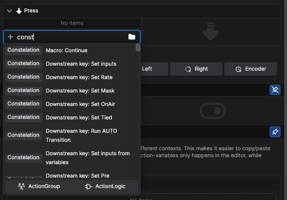

You can search directly in the **+ Add Action** field, or click on the folder icon at the end to bring up the Action selection dialog box.

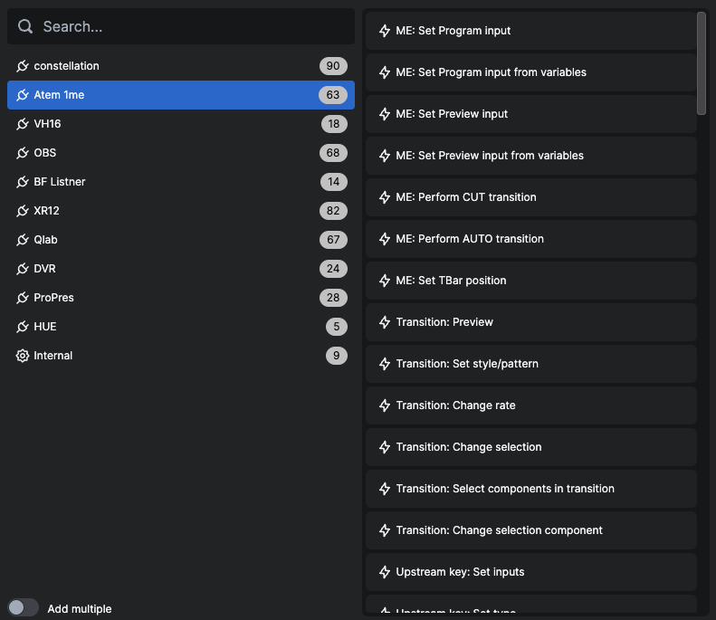

### Example: ATEM Switcher

Select *ME:Set Program Input*. The button will set the ATEM switcher's M/E 1 bus to the specified input.

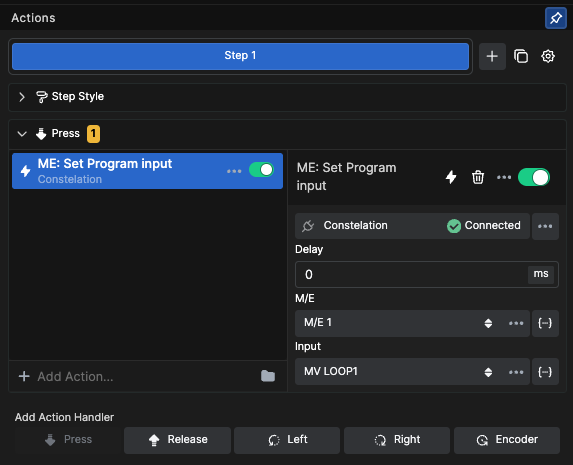

---

## Action Steps

Buttons can act as playlists, performing multiple actions sequentially.

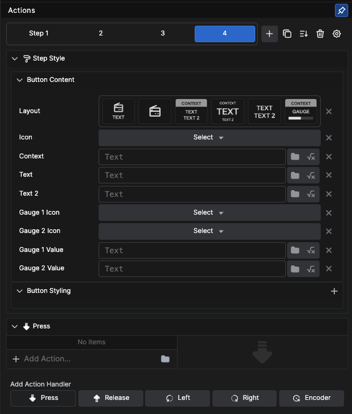

### Managing Steps

- Add steps by clicking the **+** after *Step 1*
- Use the duplicate step button to copy an existing step
- Each step has unique **Style** and **Action** dialogs
- Under the **cogwheel**, find options for auto-progress (each press advances to the next step)
- Choose between absolute or relative delays

### Renaming Steps

Double-click on a step to bring up a dialog box where you can change the name.

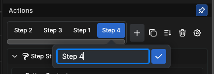

### Reordering Steps

Use the reorder option to drag steps into the position you need.

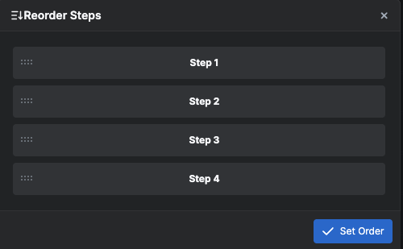

---

## Delays

### Absolute Delays

Actions start a set time after the button press (Default).

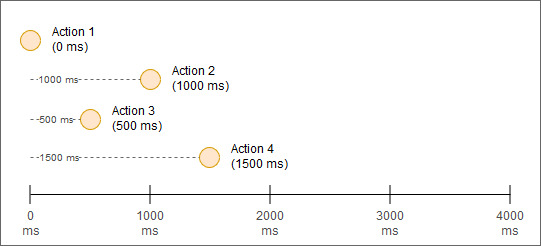

### Relative Delays

Each action runs a set time after the previous one starts.

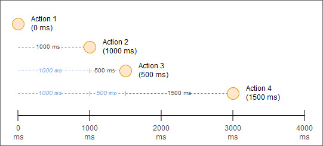

---

## Action Groups

When clicking on **+Add Action**, you are presented with options to create an **ActionGroup** or **ActionLogic**.

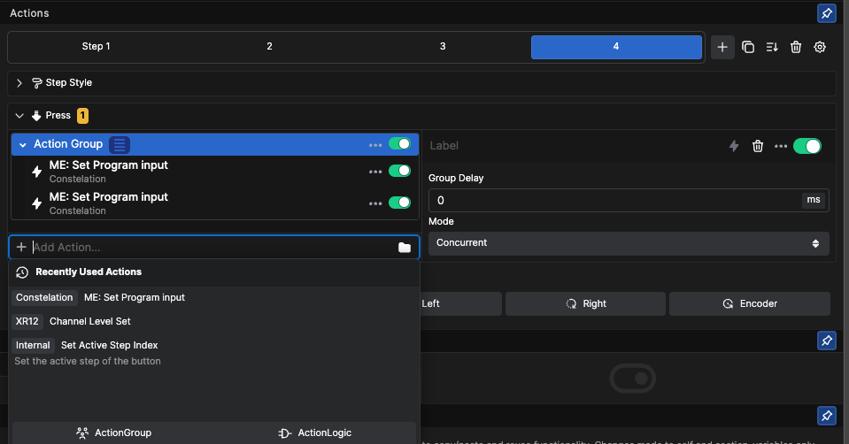

### ActionGroup

ActionGroup lets you group different actions together for either:

- **Sequential**: Actions run one after another
- **Concurrent**: Actions run simultaneously

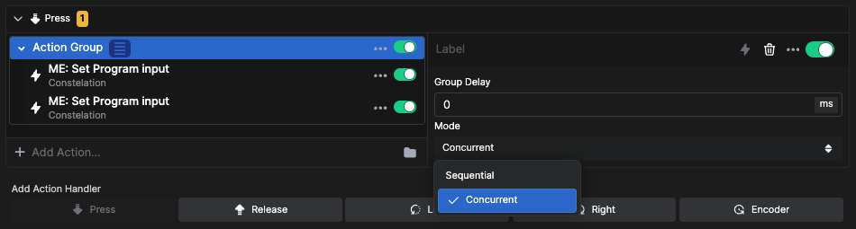

---

## Action Logic

ActionLogic lets you create conditional actions that only execute if certain conditions are met.

For conditions, you can use any feedback or use an expression to test a variable for a value.

### Example: Time-based Condition

In this example, we test the `$(time.hh)` variable for a value larger than or equal to 12 on a 24-hour clock. This determines whether it's after noon (true) or before noon (false).

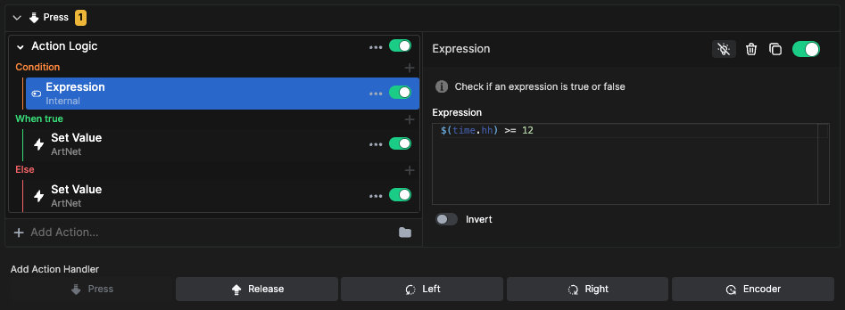

### When True

If the time is between 12:00 and 23:59, pressing the button will set the light to 255 (100%).

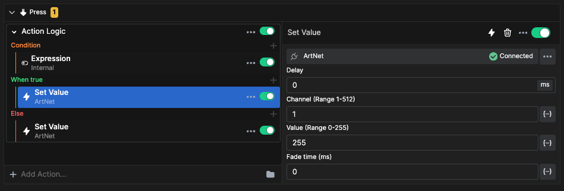

### Else

If the time is between 00:00 and 11:59, pressing the button will set the light to 128 (approximately 50%).

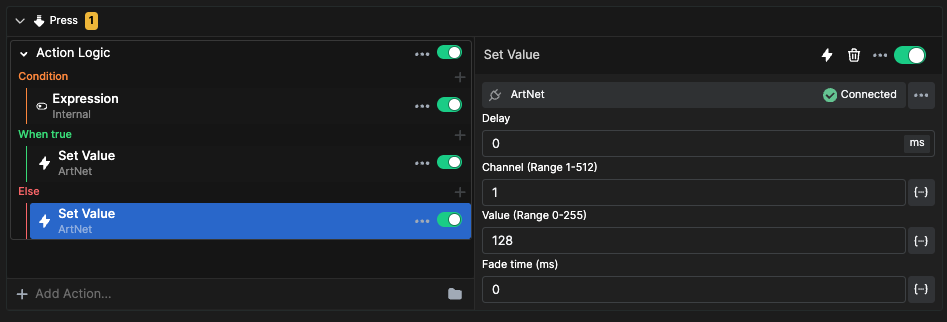

### Stacking Action Logic

You can stack multiple ActionLogics testing for different conditions, resulting in multiple different actions being executed if conditions are true.

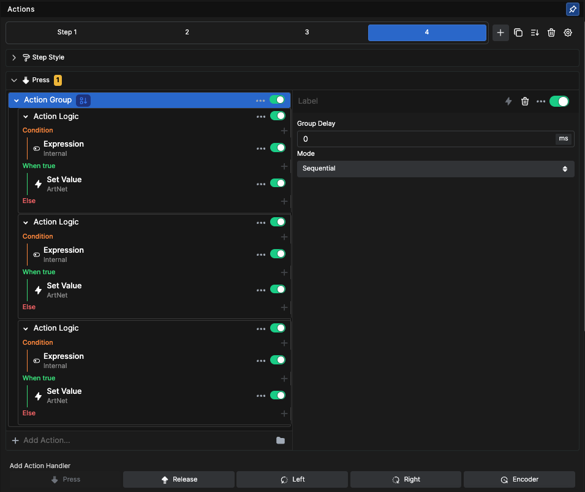

---

## Feedbacks

The **Feedback** tab adjusts button appearance based on conditions.

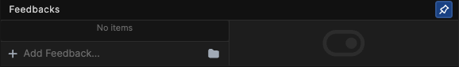

As with Actions, you can search directly in the **+ Add Feedback** field, or click on the folder icon to bring up the Browse feedback dialog box.

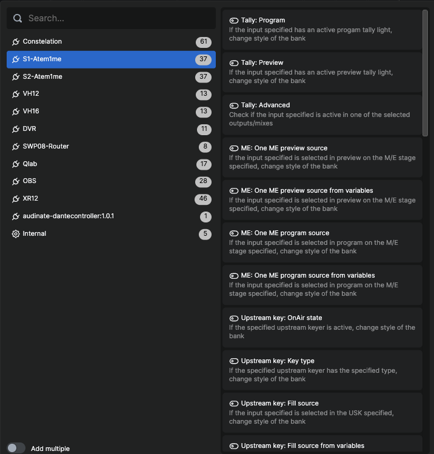

### Multiple Feedbacks

There is an option in the dialog box to select multiple feedbacks. For example, you can select both **ME:One ME preview source** and **ME:One ME Program source**.

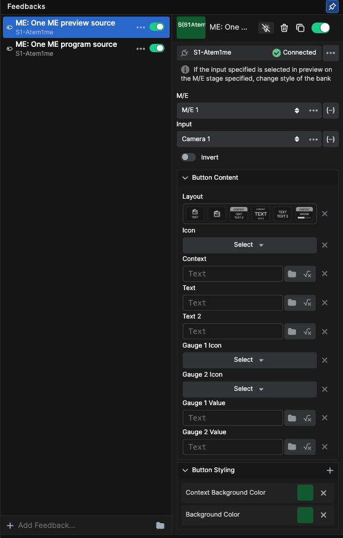

This brings two feedbacks into the button properties. Change the color for the **ME:One ME preview** feedback to green and leave the **ME:One ME Program** feedback as is.

- Button turns **red** when Camera 1 is live on the Program bus
- Button turns **green** when Camera 1 is in the Preview bus

 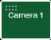

---

## Repeaters

In some connections, settings are made into dropdown lists, enabling the repeater function.

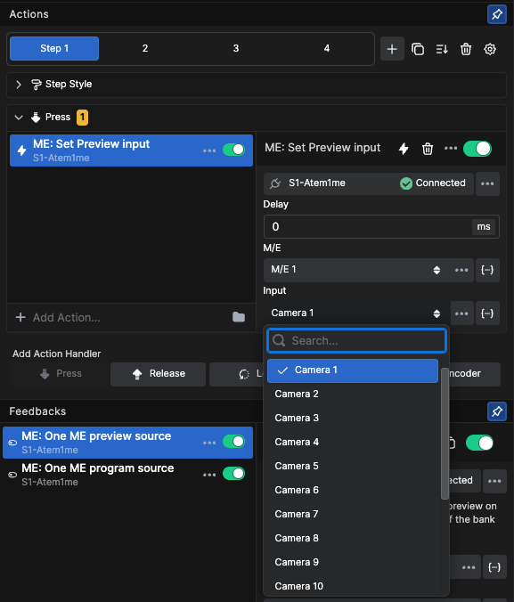

### Creating Action Repeaters

Click on the **...** menu inside the dropdown box to bring up the repeater options.

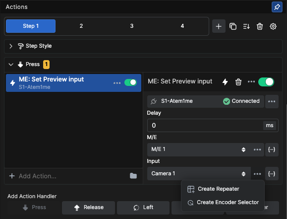

Click on **Create repeater** to automatically create a button for each item in the dropdown list.

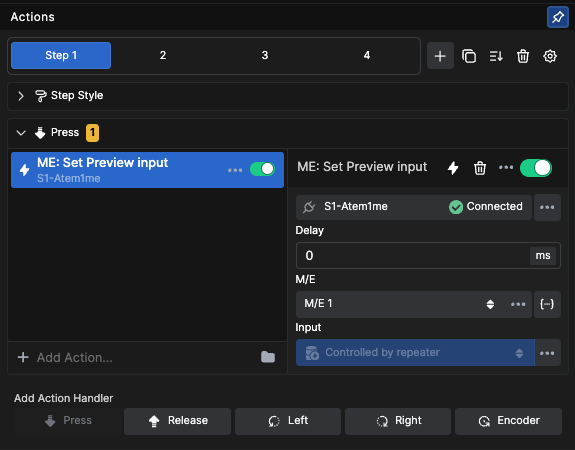

This creates 18 buttons from one single button. The first button becomes a master—if you change any styling on that button, it changes on all the "children."

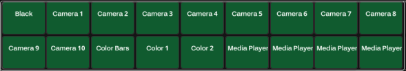

### Feedback Repeaters

Enable the repeater function on feedbacks as well.

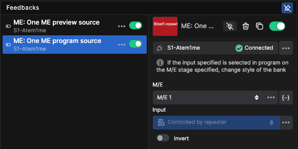

Now you have 18 buttons with feedback for both Program and Preview.

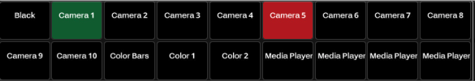

### Customizing Repeated Buttons

At the bottom of the Inspector, you'll find repeater options.

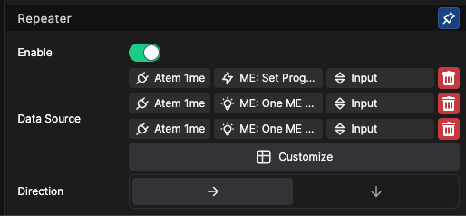

Click on **Customize** to bring up a dialog box.

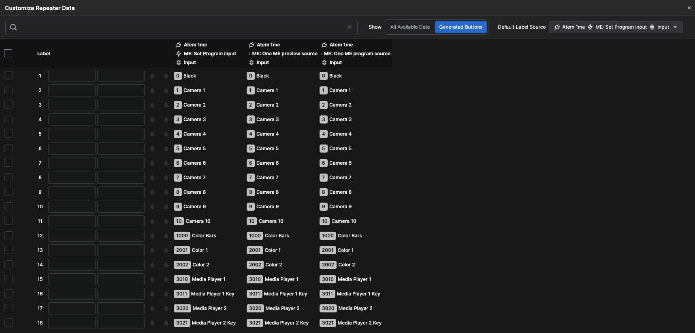

In the generated buttons window, you can customize labels, icons, and colors depending on the button style chosen for the master button.

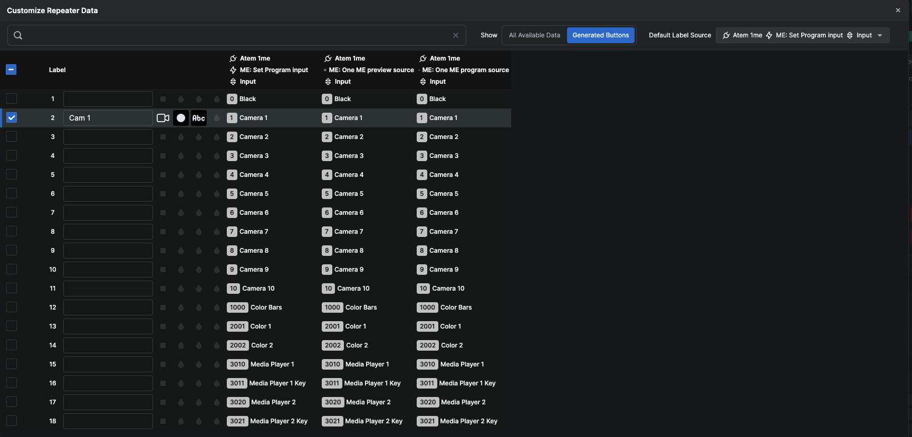

### Hiding Sources

In the "All Available Data" window, you can hide buttons for sources you don't need.

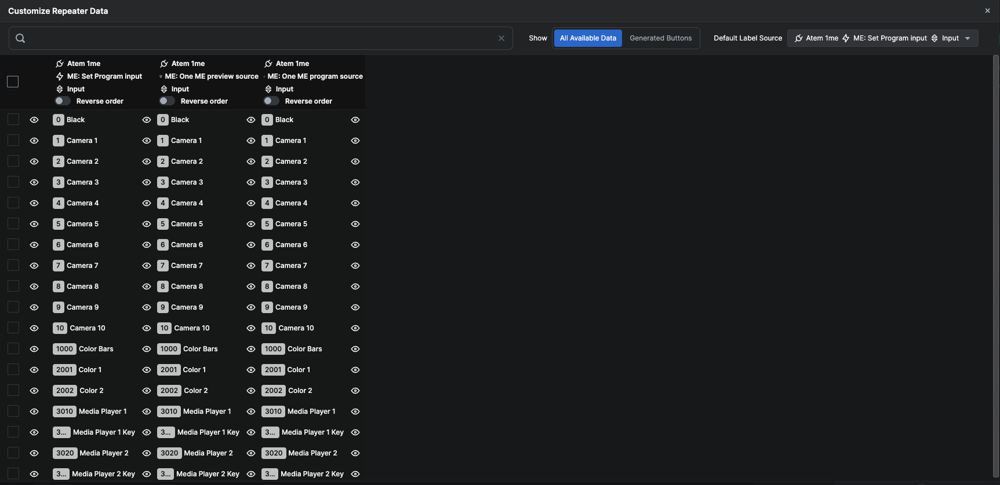

Click on the "eye" icons to hide/unhide sources.

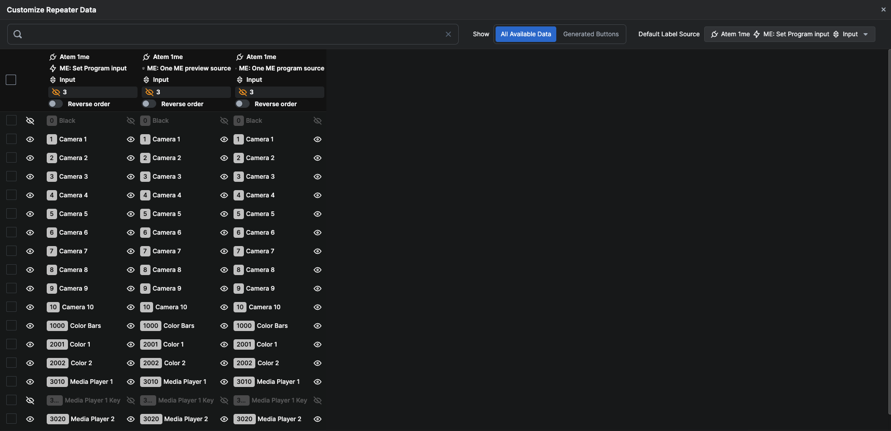

### Result

With a few clicks, you can create a simple controller for an ATEM 1ME mixer with selected sources and both Program and Preview feedbacks.

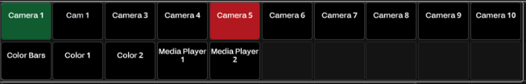

