# Encoders

Encoder actions are intended for use with surfaces that have encoders, like the **Stream Deck Studio** and **Stream Deck Plus**. However, any surface in the same position as a surface with encoders can use an encoder action.

---

## Encoder Action Basics

### Setting Up an Encoder Action

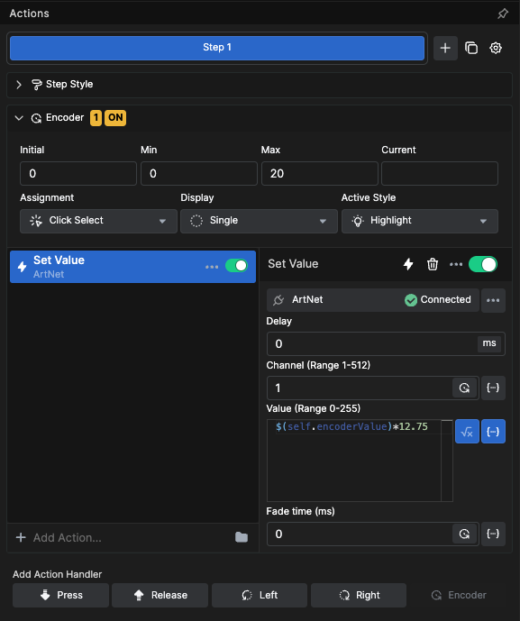

1. Change the Action handlers by turning off **Press** and **Release** (which are on by default)
2. Turn on the **Encoder** Action handler
3. This brings up encoder-specific options in the Action settings

### Min and Max Values

Set the minimum and maximum values for the encoder:

- **Min**: Set to 0 if you want the lights to be able to turn off
- **Max**: Set to limit the encoder output range (e.g., 20 for approximately a full turn)

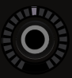

---

## Expressions with Encoders

Turn on expression mode for the **Value** option in the Action. For example, if a light accepts values 0-255 but you want only 20 encoder steps:

```
$(self.encoderValue) * 12.75
```

This multiplies the encoder value (0-20) by 12.75 to get values between 0 and 255. Each button holds its own encoder values, so no need to track anything externally.

---

## Repeaters with Encoders

### Creating Multiple Encoder Buttons

When the value range isn't in a dropdown list, use repeater mode differently:

1. Scroll down to the bottom of the Inspector
2. Turn on the repeater
3. Type in the amount (e.g., 32 for 32 buttons)

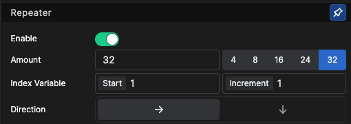

### Distributing Values

Use `$(self.repeatIndex)` to distribute values across buttons:

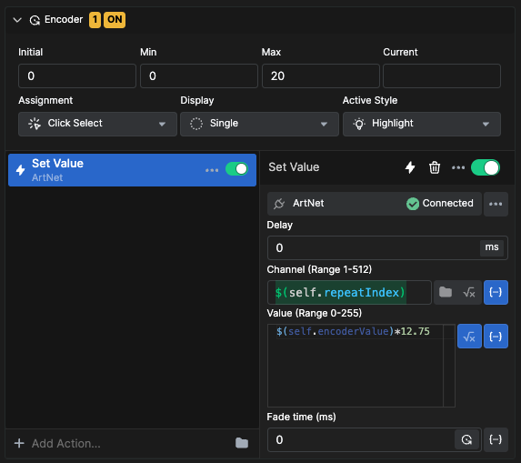

Enable variable mode for the channel option and input the variable to distribute channels 1-32 across 32 buttons.

### Labels with Expressions

Choose the Gauge style and turn on expression mode for the text box:

```
$(self.encoderValue)*5
```

This gives values from 0-100, which may make more sense for users.

For the Context text box, browse for `$(self.repeatIndex)` to show the channel number.

### Gauge Values

For the Gauge 1 Value, use an expression:

```
($(self.encoderValue)*5)/100
```

A 0 value shows an empty gauge; 1 fills it. This expression produces 20 values between 0 and 1.

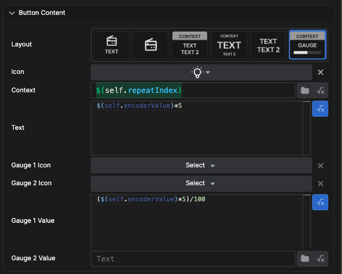

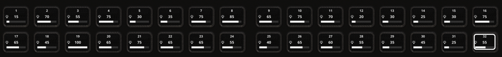

---

## Using Encoder Buttons

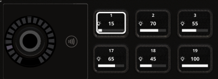

To assign the encoder to any button:

1. Press the button to highlight it
2. Turn the encoder to adjust the value
3. Release by pressing the button again, pressing the encoder, or selecting another button

The LED ring around the encoder lights up to reflect the level.

---

## Encoder Settings

### Assignment Modes

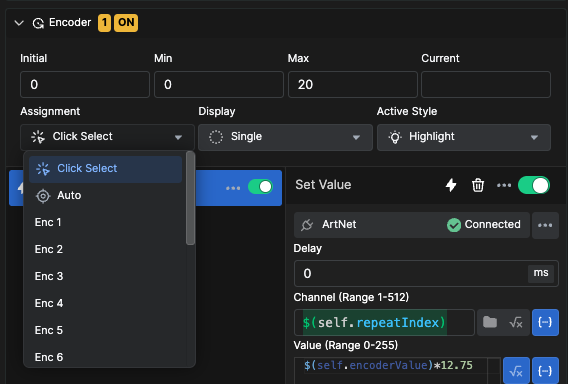

- **Click Select** (Default): Push a button to assign all unassigned encoders in the position to that button
- **Auto**: Auto-assigns encoder actions to the closest encoder. Ideal for Stream Deck Plus where encoder action buttons are on the touch screen above the encoders
- **Enc 1-16**: Force-assigns an encoder action to a specific encoder in the position

### Display Modes

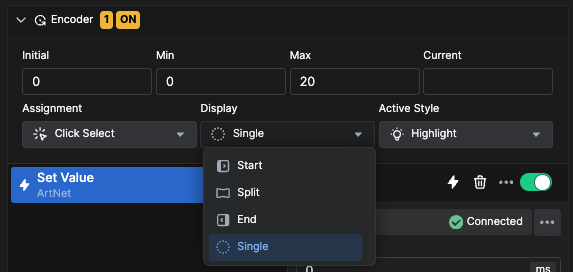

- **Single** (Default): Lights up one LED for each step between Min and Max values
- **Start**: Lights up and keeps on one LED for each step between Min and Max
- **Split**: Mimics a pan or balance indicator with Left, Center, Right indication
- **End**: Opposite of Start—starts with all LEDs on, turning off as you approach Max

### Active Style

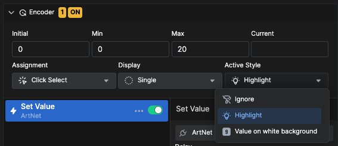

- **Ignore**: Shows no change on the button assigned to an encoder
- **Highlight** (Default): Shows a white outline on the assigned button
- **Value on white background**: Shows the encoder value and **Text** value in black on white

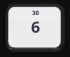

---

## Encoder Selector

The encoder selector works with values available in a dropdown list. This example uses a Behringer XR12 audio mixer.

### Setting Up an Encoder Selector

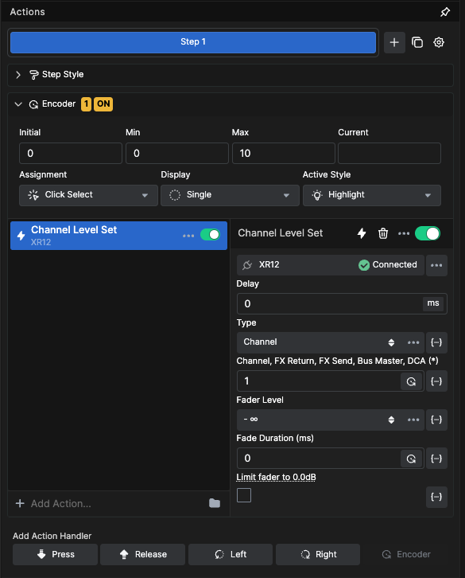

Add the Channel Level Set Action.

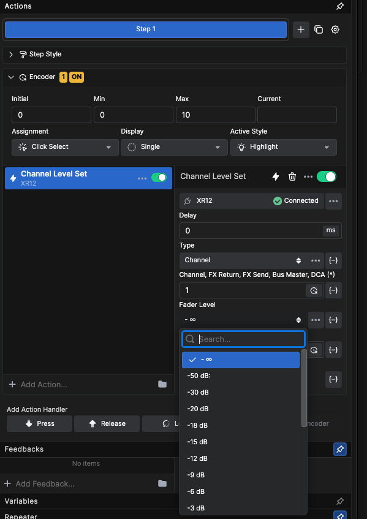

The Fader level has preset values in a dropdown list.

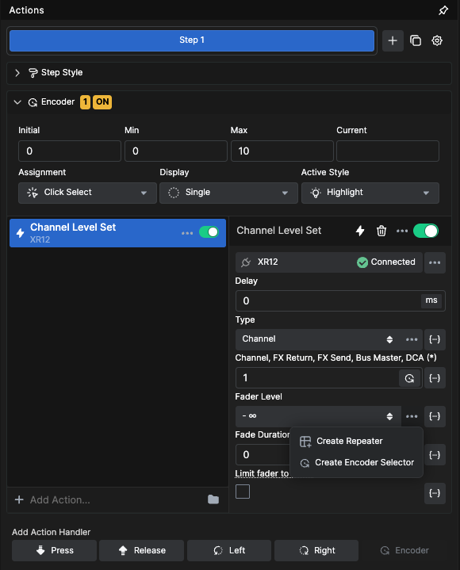

Click the **...** menu at the end of the dropdown selector and select **Create encoder selector**. This assigns an encoder to select between the different levels.

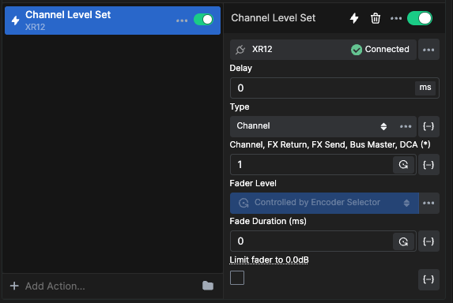

### Encoder Selector Variables

- `$(self.encoderSelectorValue)`: Holds the actual value (e.g., a decimal between 0 and 1)
- `$(self.encoderSelectorLabel)`: Shows the values from the dropdown list

Put either variable in a Text field to see the content and determine if it's useful.

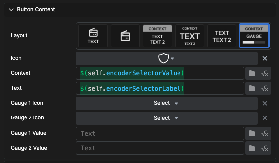

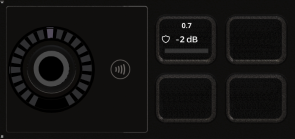

### Gauge with Selector Value

Use `$(self.encoderSelectorValue)` in the **Gauge1 Value** to give the gauge the logarithmic feel of actual values sent to the mixer.

### Creating Multiple Channel Controls

Use the repeater function to create buttons for all channels:

1. Enable the repeater at the bottom of the Inspector
2. Enter the number of channels (e.g., 12 for XR12)
3. Put `$(self.repeatIndex)` in the channel selector of the action

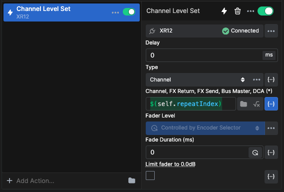

### Using Concat Function

Use the `concat` function in expressions to combine strings and variables for more understandable labels:

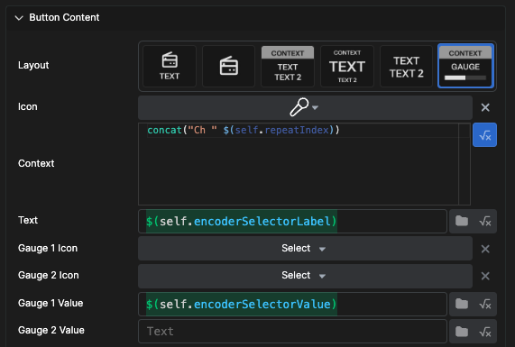

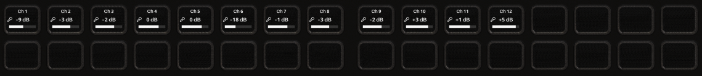

