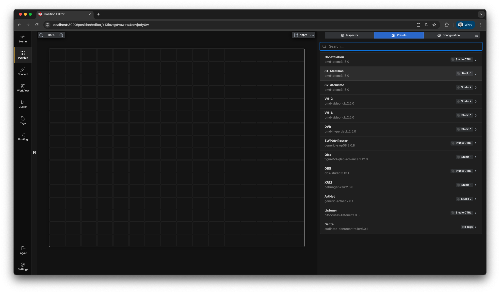
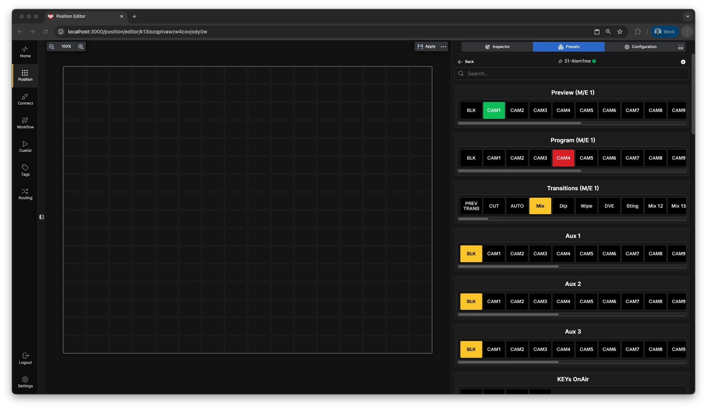
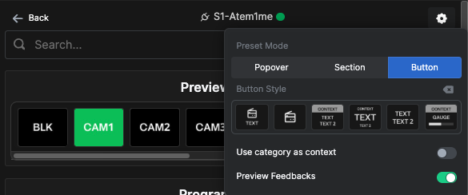
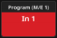
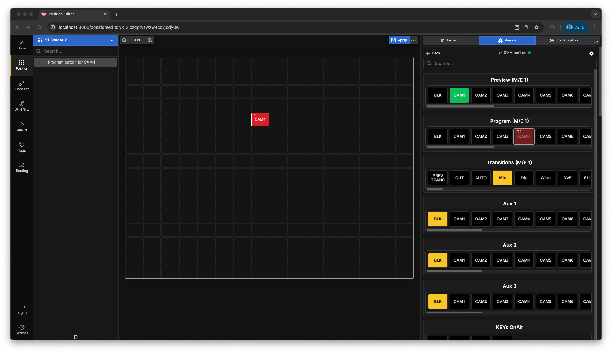
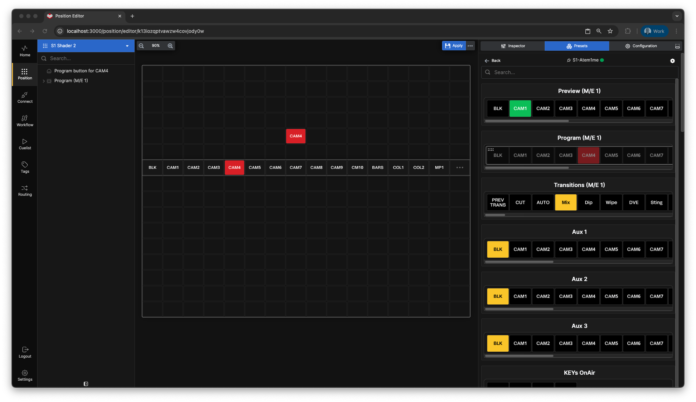
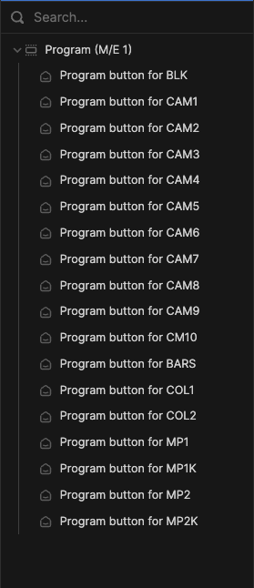
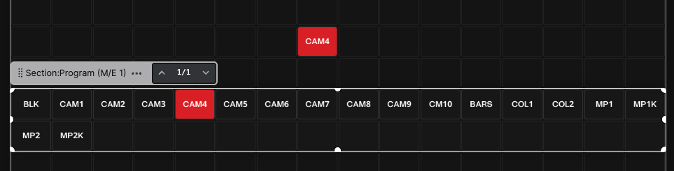
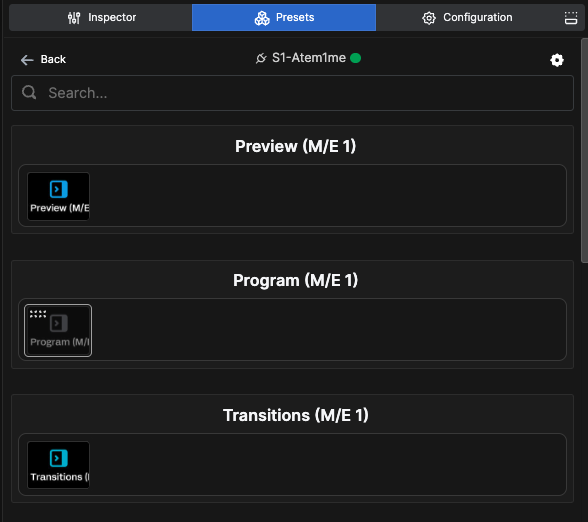
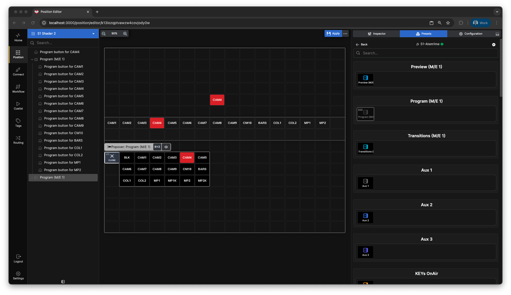

# Presets

Select the **Presets** tab in the right pane of the window. This presents a menu of all connections. **Presets** are pre-configured buttons designed by the module author to simplify the process of creating complete buttons for easy deployment, often pre-configured with both Actions and Feedbacks.

---

## Preset Settings

In the **Settings** menu, you can:

- Customize the style of the preset
- Add the category as a contextual label for the button

---

## Drag Modes

### Button Mode

With the **Button** option, you can grab one button at a time from the preset pane and drop it on the canvas.

### Section Mode

With the **Section** option, the entire row of buttons is highlighted and can be dragged onto the canvas as a section.

Notice the **...** button at the end of the section. This indicates the section extends beyond the visible canvas. Clicking it reveals additional buttons.

### Editing Preset Sections

After dragging a section onto the canvas, you can edit it as needed:

- Delete unwanted buttons individually (be cautious to select the specific button, not the entire section)
- Delete buttons via the tree view by **CMD/CTRL + clicking** their labels
- Resize the section as needed

### Popover Mode

The **Popover** section typically contains a single button. Drag it onto the canvas and push it to see it in action.

The Popover button expands and unfolds over other buttons on the canvas, providing a space-efficient way to display less frequently used buttons while keeping them accessible.

---

## Important Notes

This overview of presets highlights how they can accelerate setup—whether for a small, single surface configuration or a large-scale deployment with multiple positions and hundreds of surfaces.

Keep in mind:

- Not all connection modules include presets
- Not all actions are available as presets
- If you can't find a preset that meets your needs, explore the actions in the module—you may still achieve your goal by manually creating the button

