# Variables

## What Are Variables?

A **variable** is like a labeled container in the computer's memory. Imagine a box with a name on it—for example, "Score" or "Username." Inside this box, you can store different kinds of information: numbers, text, true/false values (booleans), or even code.

The main characteristic of a variable is that the information it holds can change. For instance, a "Score" variable might start at 0 and increase as points are earned.

---

## Naming Variables

Variables should be given clear, descriptive **names** (like "score," "username," or "channel"). This makes it easy for users to understand what kind of information they hold and to refer to them later.

It's important that each variable has a unique name where it is visible. No two variables that are visible in the same place can have the same label. One way to manage this is with **Variable Scope**.

---

## Variable Scope

The **scope** of a variable determines where it is visible or available for use.

- **Global Scope**: Every part of a program can see and use the variable
- **Local Scope**: Only a small part (like a function or section) can see and use the variable

For small, single-user setups, scope might not matter much. But as configurations grow with multiple Positions and similar connections, managing Labels and Scope becomes critical.

> **Note:** Most user-facing variables have at least a runtime lifespan. Some also have a **Persist** option, which saves the value through shutdown or restart.

---

## Connection Variables

Connection variables are **global** to Buttons—all parts of Buttons can see and use them. Connections cannot directly see or manipulate other connection variables. However, Buttons can manipulate variables in one connection based on variables from another.

Connection variables are manipulated through functions built into the connections, made available as Actions, Feedbacks, and Variables.

### Variable Key

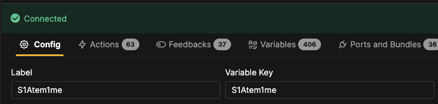

The Variable key is set in the config view of the connection and becomes part of the variable name.

If you have more than one of the same connection, you must have different Variable keys for each. It's good practice that the Label and Variable key resemble each other so the connection between the two is easy to understand.

### Viewing Connection Variables

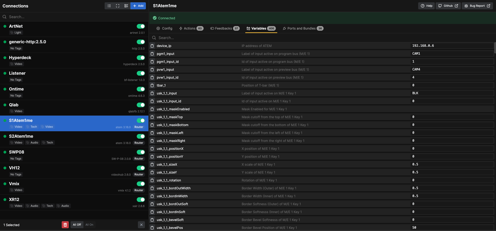

Connection variables can be viewed in the variable view of the connection. Click the clipboard icon to copy the full variable name.

Example: `$(S1Atem1me.device_ip)`

The full variable name combines the Variable key and variable name. The view also shows variable descriptions and current values.

---

## Section Variables

Section variables combine two concepts: **Self Variables** and **Parent Variables**.

### Self Variables

Variables created inside a button or section, local to that element. They are not visible to other buttons or sections and cannot be used outside.

### Parent Variables

A Self variable of the parent element, made available to the child element through the Parent variable.

You can create multiple self and parent variables in each element, but they must have unique names within that element. You can freely reuse variable names from self and parent elements in other elements since they have local scope.

### Scope Example

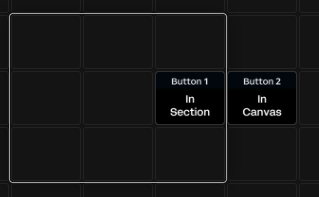

Two copies of a button on the canvas: left one inside a section, right one directly on canvas.

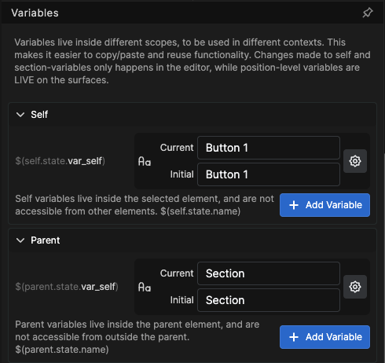 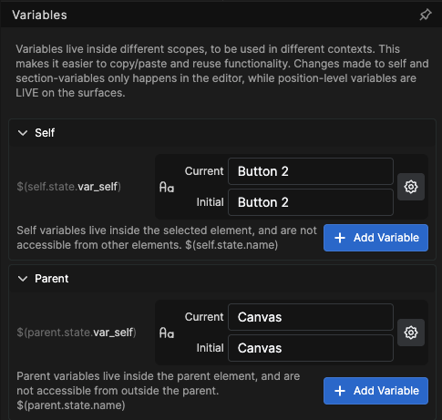

Both buttons have `$(self.state.var_self)` with different values ("Button 1" and "Button 2"). This works because self variables only live inside the button—they can coexist and hold different values without affecting each other.

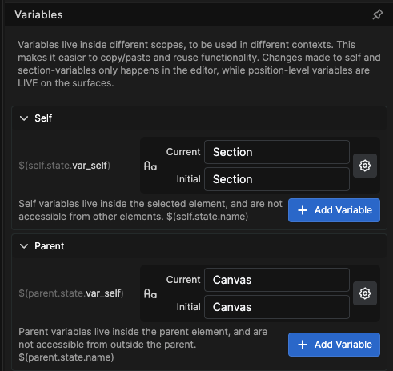

Parent variables also have the same label but different values, indicating different scopes. They only live inside the parent element.

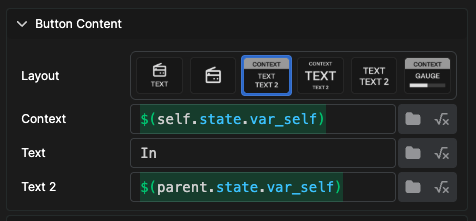

Looking at the Section, its self variable holds the same value as the button's parent variable, demonstrating that a Parent variable in an element is a self variable of the parent element.

---

## Position Variables

Position variables are defined as **global variables**—all positions have the same variable definitions. However, each Position has its own Current and Initial value, independently of each other.

The values can also be used by any shared section in a position, getting the value from the position they are mounted on.

### Configuration Pane

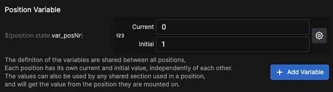

### Inspector Pane

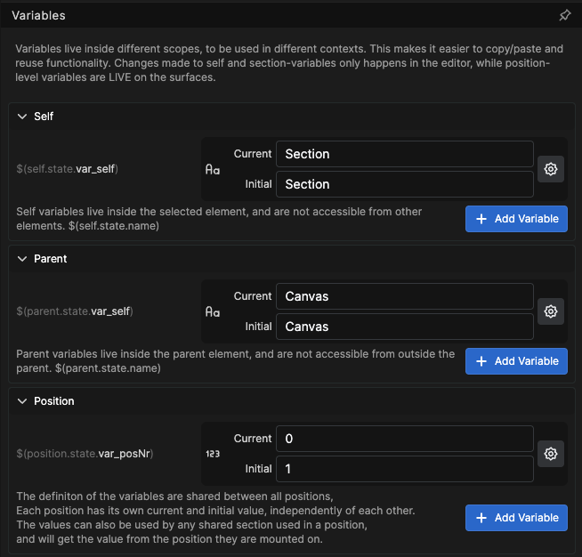

Position Variables can be defined in the configuration or in the inspector for any element inside the Position. Creating a new position variable in any position makes it available in all positions, but the value is individual for each position.

This makes the **Variable definition Global** and the **Variable value Local**.

### Connection Type Variables

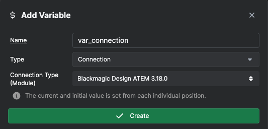

Position Variables can use a connection as a variable type.

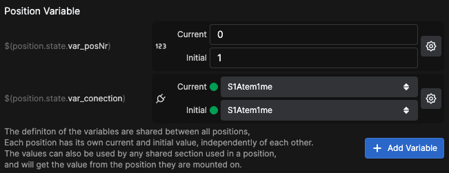

Define the variable with the connection you want to use (requires multiple connections using the same module).

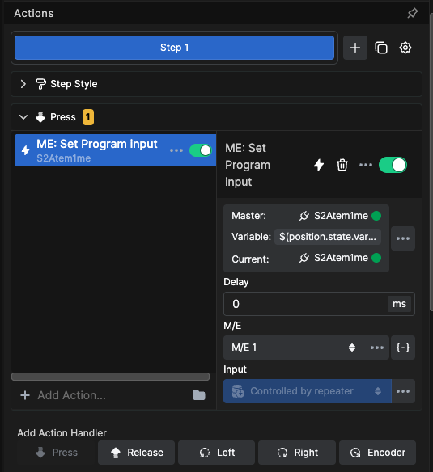

Use the variable to define which connection should be connected to actions in a position. Create a button with the **Set Position Variable** internal action to swap out the connection in use.

 

This can also work with shared sections where the connection is determined by the position connection variable.

---

## Workflow Variables

Workflow variables are defined as **global variables** and are available for both reading and writing from all over Buttons.

### Creating a Workflow Variable

Go into Workflows. Create a workflow if needed.

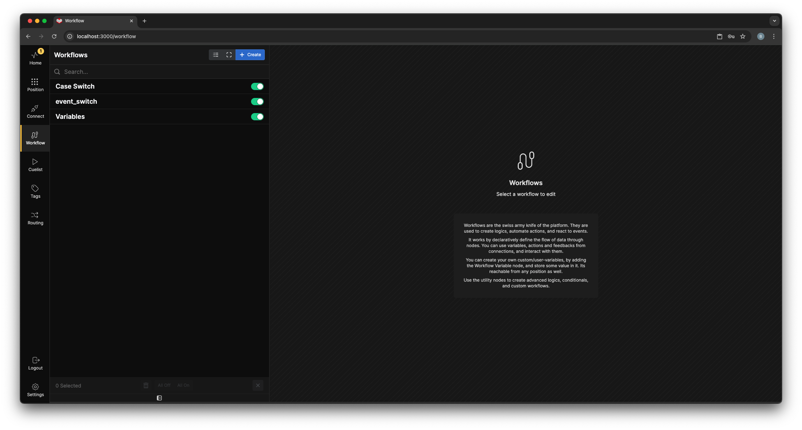

Inside the Workflow, create a workflow variable by clicking and dragging a workflow variable node onto the canvas.

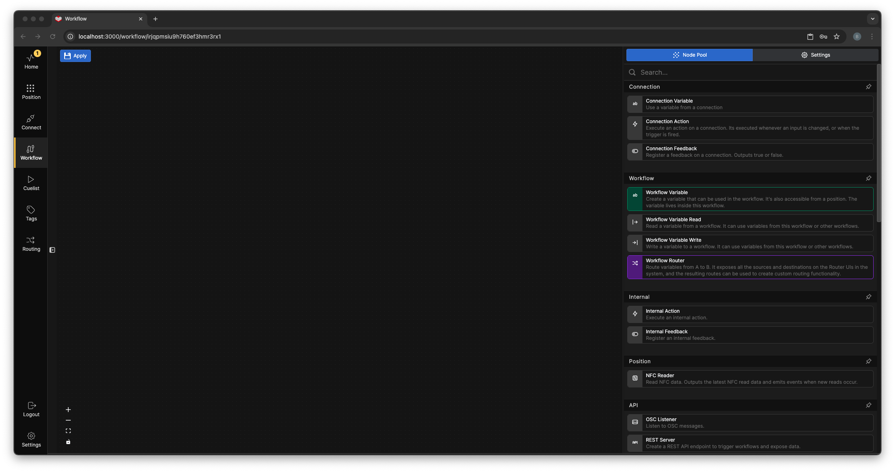

Give the variable a unique name (remember it will be globally available).

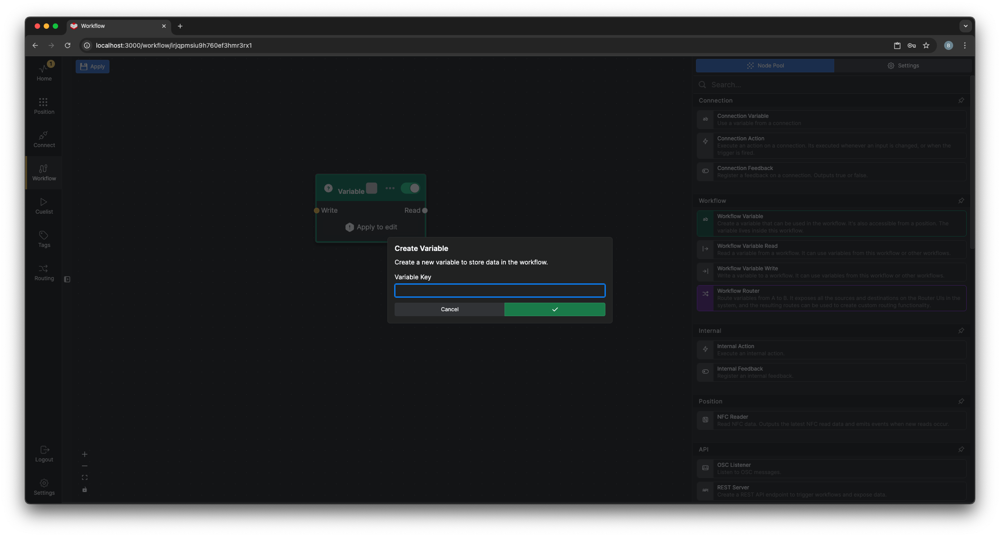

Click **Apply** to edit the variable.

### Variable Settings

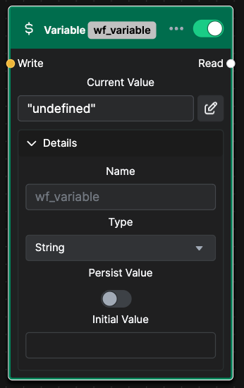 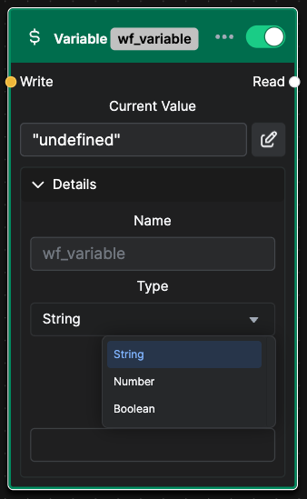

- **Type**: String (default), Number, or Boolean
- **Initial Value**: Starting value at each restart
- **Persist**: Save current value through restart
- **Current Value**: Required for Number and Boolean types

### Workflow Settings

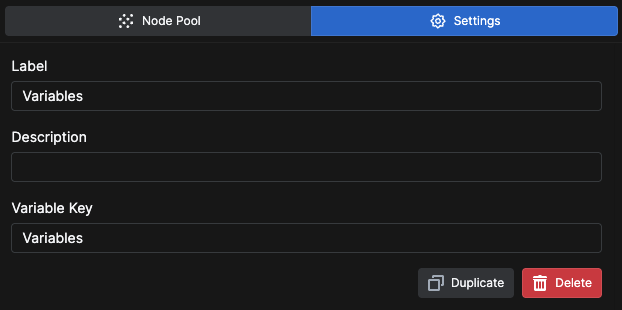

The **Variable Key** in Workflow settings affects the variable name. By default, it matches the Workflow name.

---

## Using Variables

### Variable Browser

Most text boxes in the Inspector have a folder button.

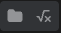

Click the folder icon to open the Variable browser and select from available variables.

### In Labels

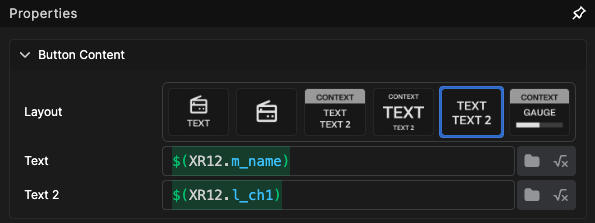

Insert a variable as a label in a text box.

### In Actions

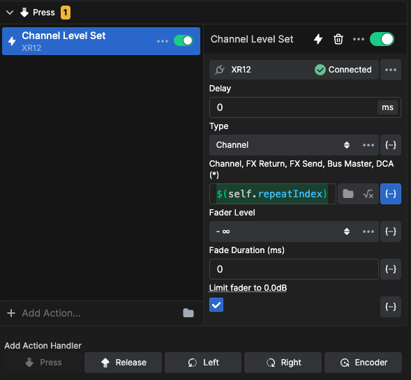

Insert a variable as a value in an action.

### Expressions

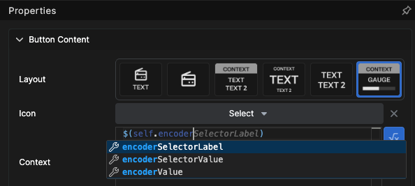

Use expressions to calculate values from variables. The expression dialog suggests options as you type.

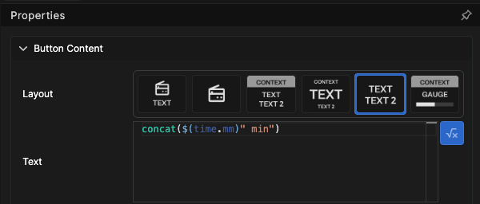

Use functions like `concat` to combine multiple variables and text.

---

## Internal Actions

### Set Workflow Variable

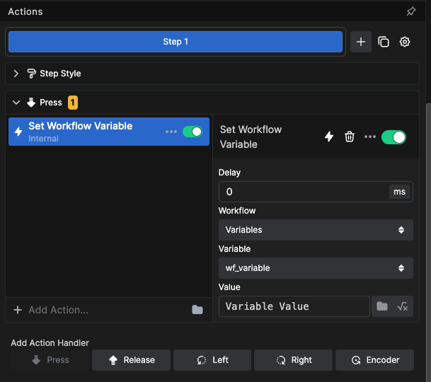

Change the value of a Workflow variable.

### Set Section Variable

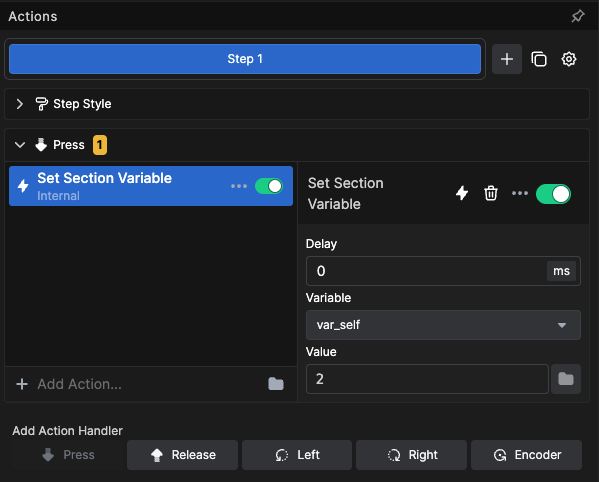

Set the value of a parent variable in the button that uses the action. This actually sets a self variable of the section that holds the button.

### Set Position Variable

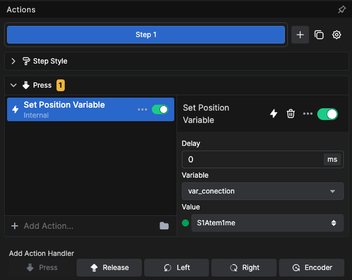

Set the value of a position variable in the position where the action is executed.

