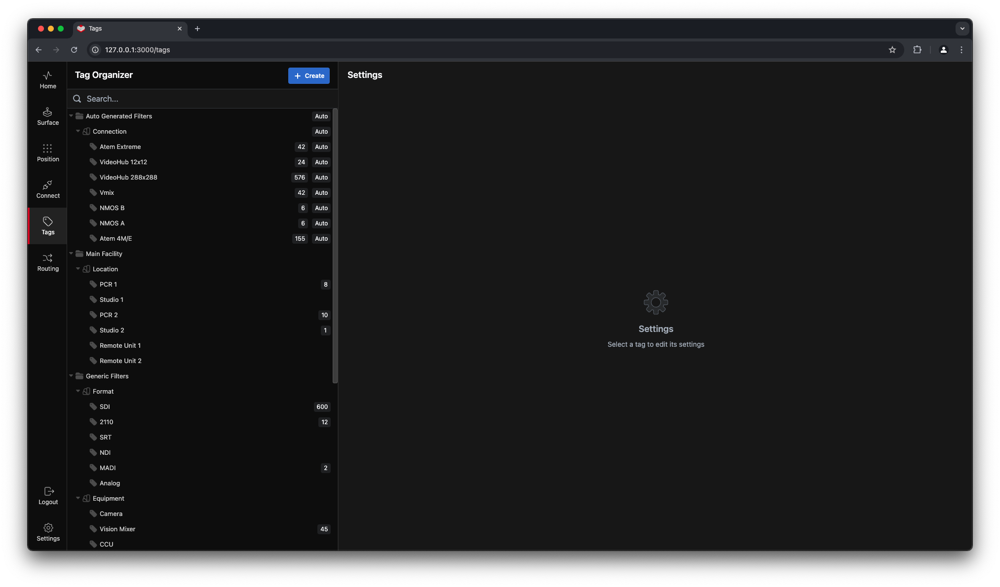
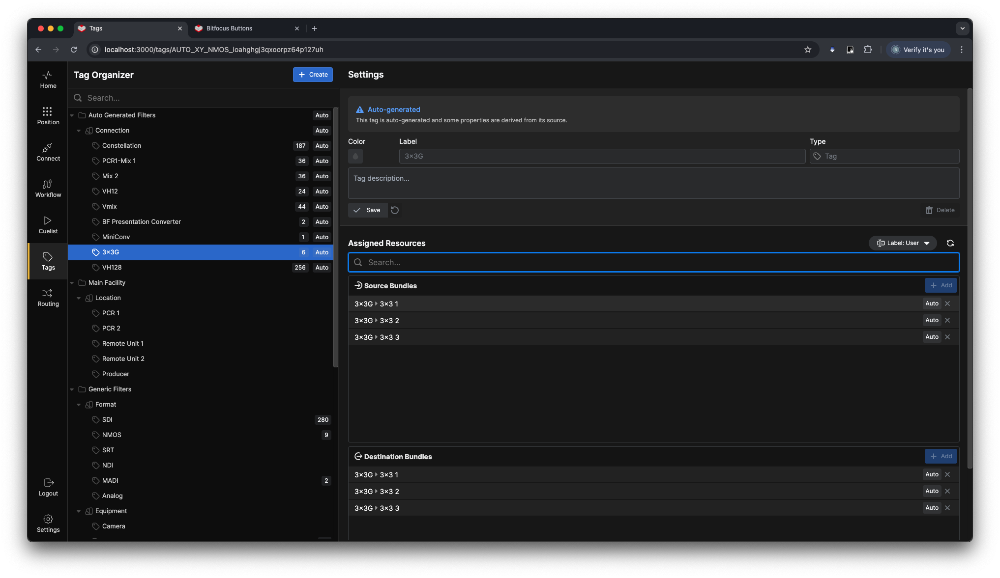
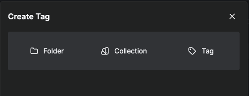
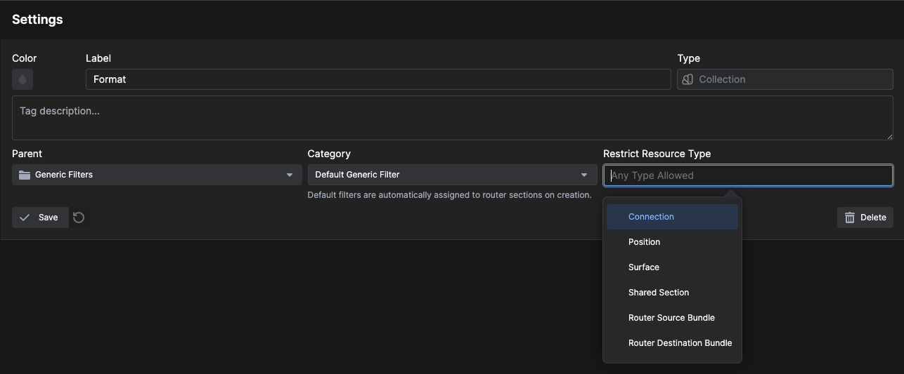
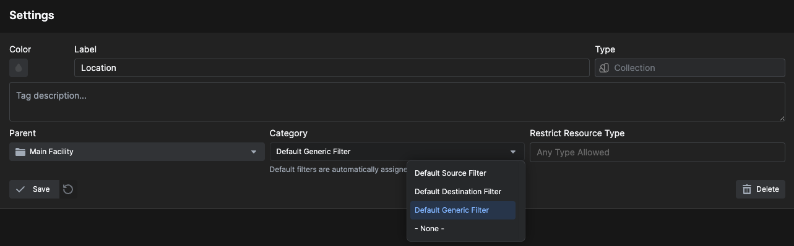

# Tags

**Tags** are keywords you can add to different elements of **Buttons** to create an organizational structure or filter search results.

Large implementations of Buttons can greatly benefit from additional organizational structure. Add tags and organize according to your needs—for example, "studio name," "room number or name," "floor plan number or name," and so on.

You can add tags to:
- Connections
- Surfaces
- Positions
- Most other parts of Buttons

Tags help group elements together and are useful in searches and filters.

---

## Auto-Generated Tags

**Buttons** automatically adds tags as you add connections and other elements to your system. Some organizational tags are also included by default. Feel free to change or add to them as needed.

---

## Creating Tags

When you click **+Create**, the following dialog appears:

### Folder

Folders organize your Collections into logical groups.

### Collection

A Collection can contain multiple Tags. Collections are used to:
- Group Tags together
- Create filters

### Tag

Creates a new Tag. Every Tag must belong to a Collection.

---

## Restrictions

By default, you can assign any tag to any resource. However, you can restrict a Collection to one or more resource types.

---

## Categories

Define what category a collection belongs to, which controls where tags will be automatically assigned.

