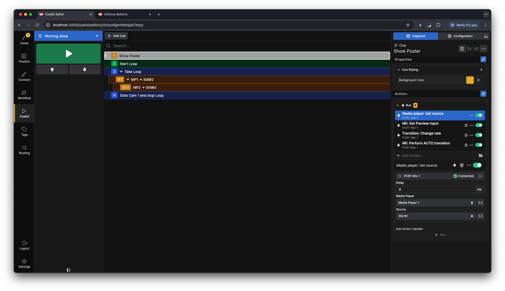
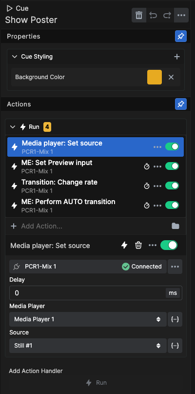
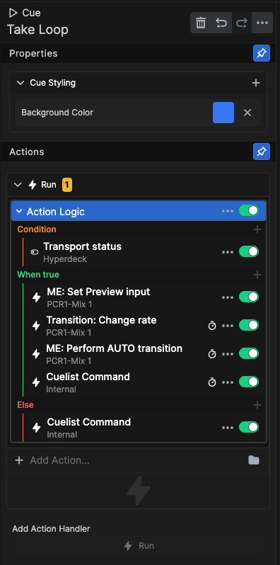
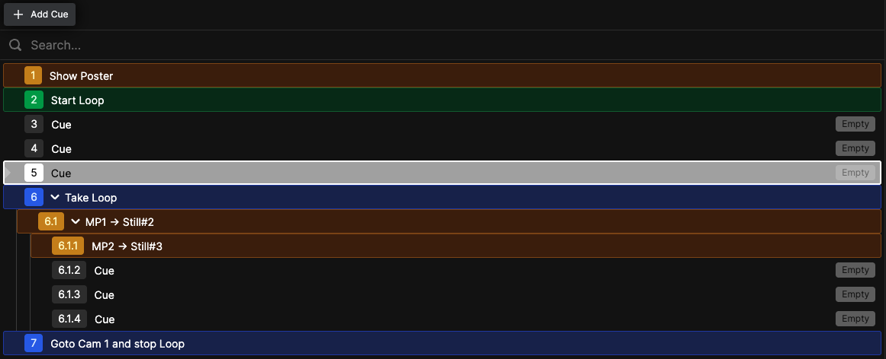
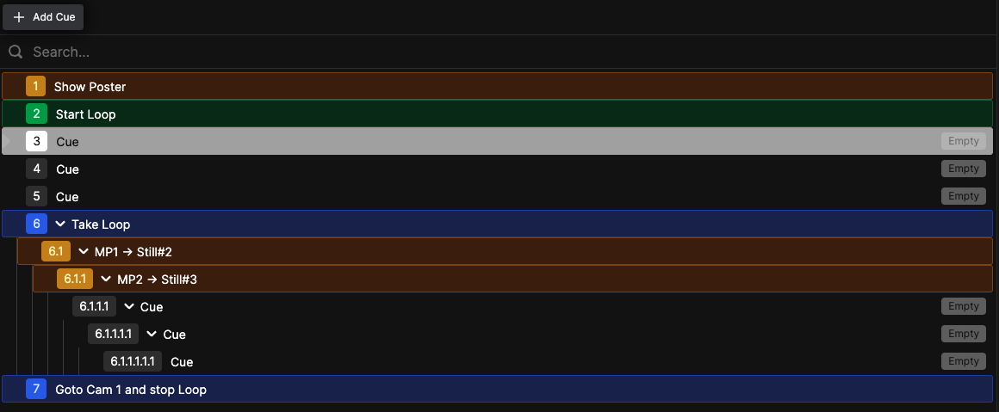
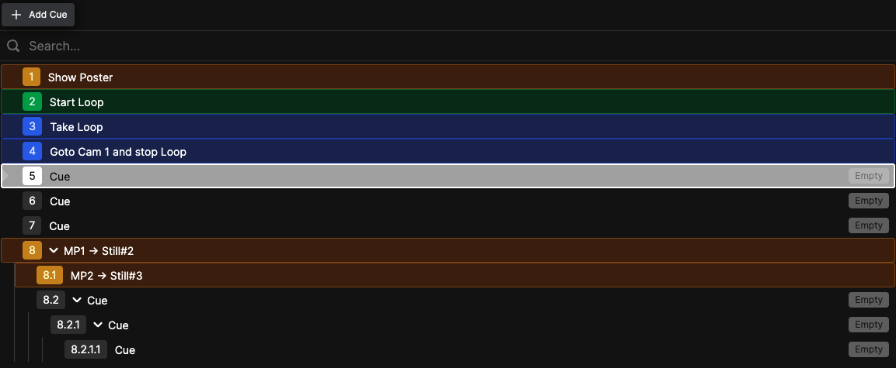

# Cuelist

In the Cuelist, you can build all cues (lighting looks, camera shots, video clips, audio triggers, etc.) in a list format similar to a spreadsheet or newsroom rundown. Each row represents a cue, and each cue can execute multiple actions—either all together or timed. The Cuelist can also control its own advancement.

---

## Cue Properties

Each cue can have:
- A name
- A color
- Multiple stacked actions

---

## Conditional Logic

You can use conditional logic to control the flow of cues. A condition is tested for true or false, determining which actions execute.

---

## Adding Cues

Add cues and sub-cues after the currently selected cue by clicking the **+ Add Cue** button.

---

## Sub-Cues

Make a cue a sub-cue of another cue by dragging and dropping it on top of the parent cue.

---

## Reordering Cues

To reorder cues, drag and drop them between the cues where you want to insert them. The cuelist will auto-renumber on any changes to the order.

---

## Navigation

> **Tip:** There are Internal Actions to navigate the cuelist, allowing you to control cue execution from buttons.

