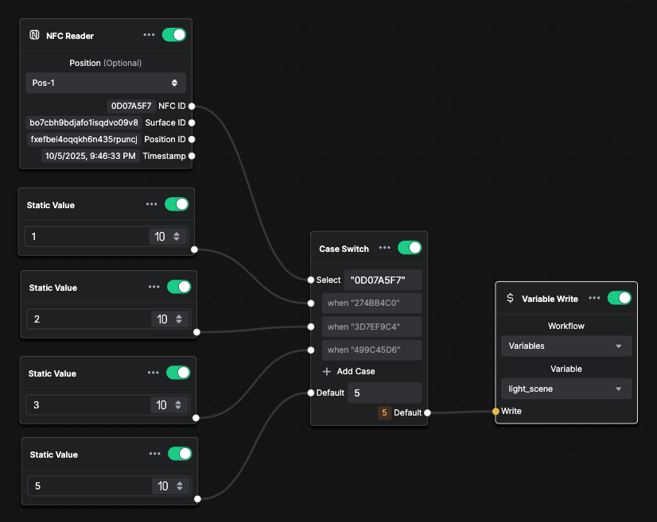
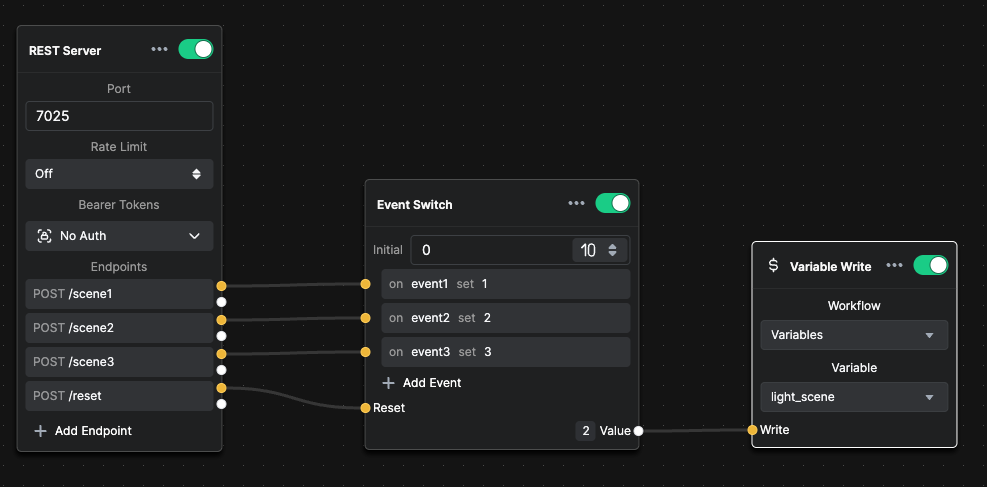

# Workflow

> **Coming Soon**
>
> The Workflow feature is currently under development. This documentation will be updated when the feature is fully available.

## Overview

Workflows allow you to create visual, node-based automation flows within Buttons. They provide a powerful way to:

- Create complex automation sequences
- Define event-driven responses
- Manage workflow variables
- Build conditional logic flows

## Preview

## Workflow Variables

While the full Workflow feature is in development, you can already use Workflow Variables. See the [Variables](12-variables.md#workflow-variables) documentation for details on creating and using workflow variables.

