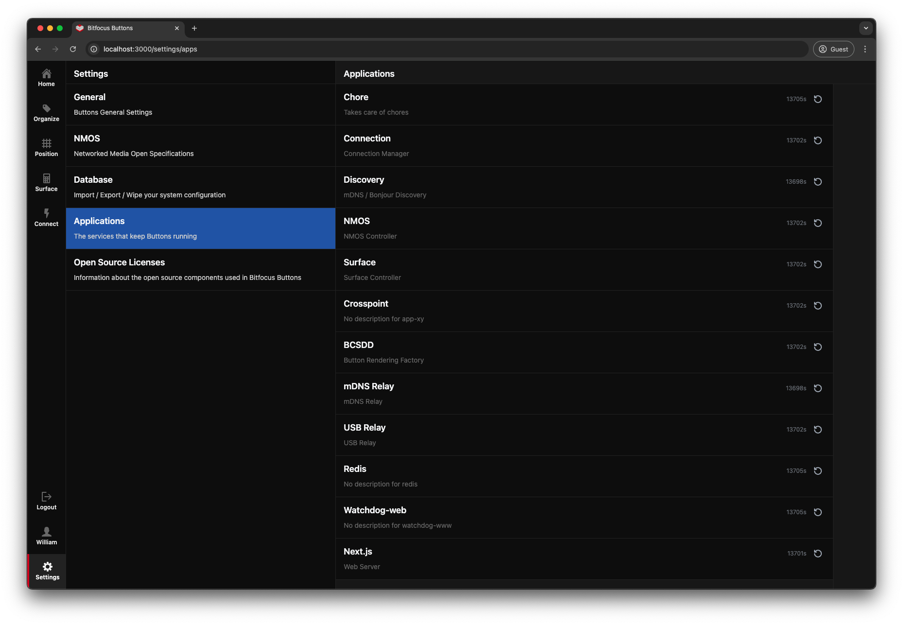

# Settings

> **Documentation Coming Soon**
>
> Detailed settings documentation is being prepared. This page will be updated with comprehensive coverage of all system settings.

## Overview

The Settings page provides access to system-wide configuration options for Buttons, including:

- Network configuration
- System preferences
- License management (see [Getting Started](01-getting-started.md#licensing))
- User preferences
- Backup and restore options

For license management details, refer to the [Licensing](01-getting-started.md#licensing) section of the Getting Started guide.

