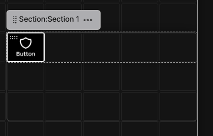
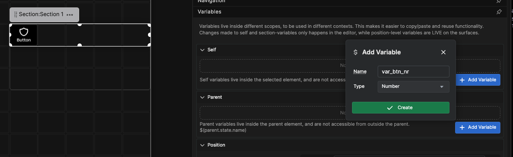
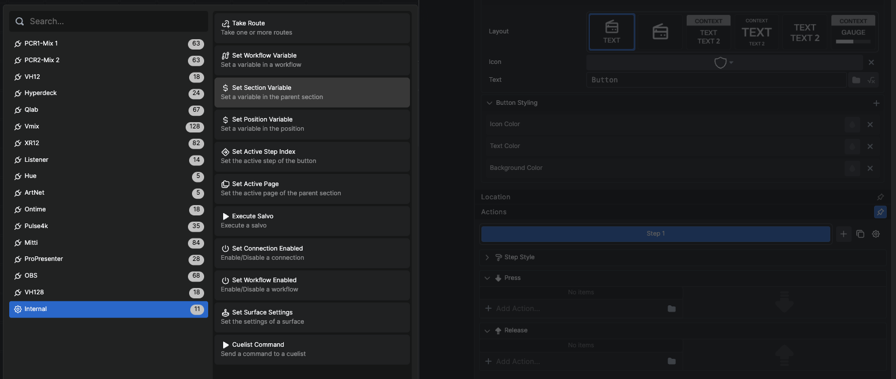
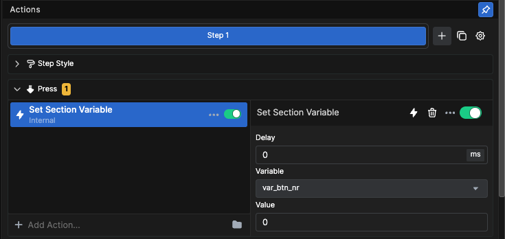
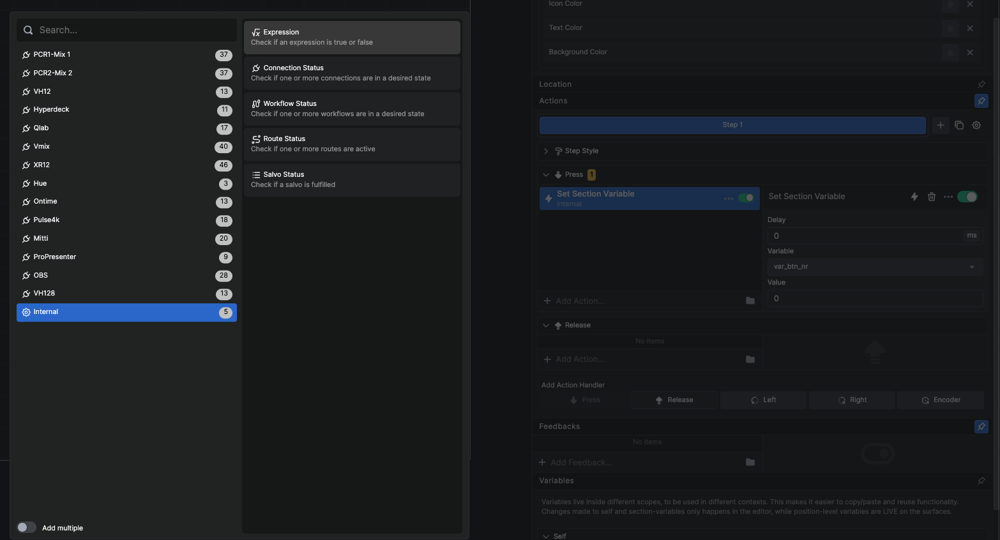
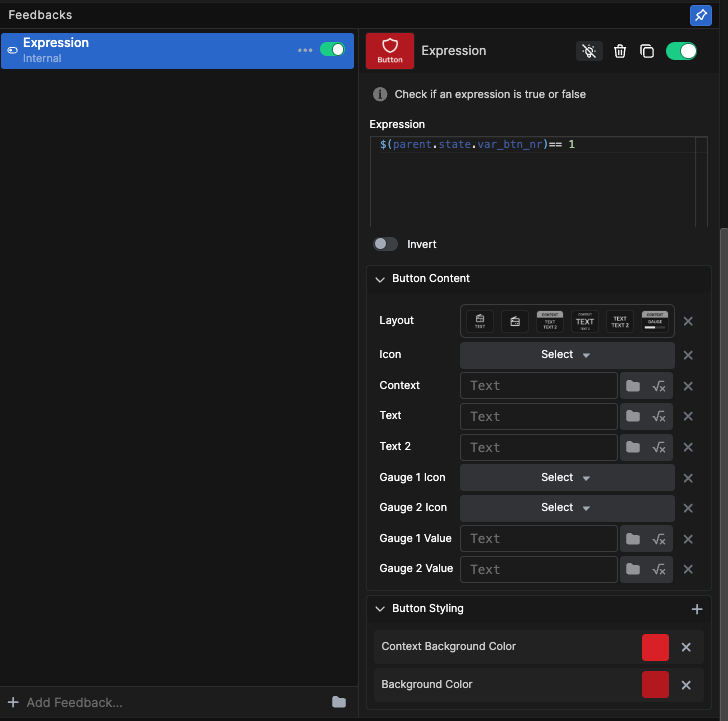
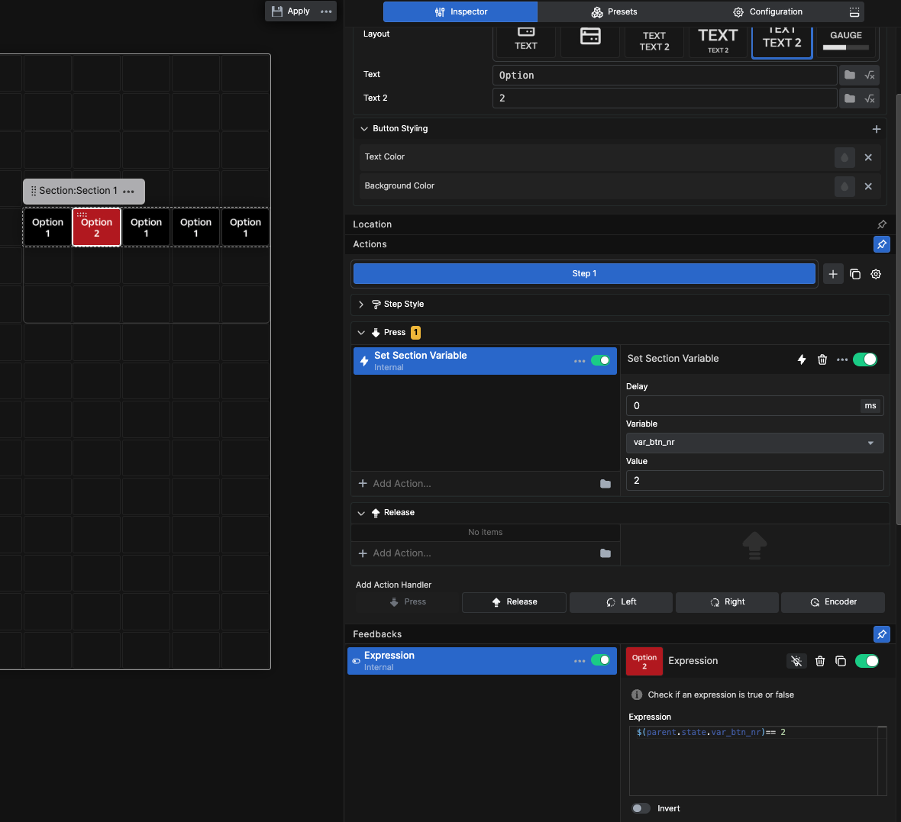
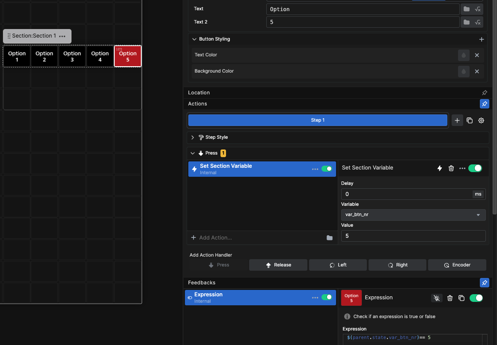
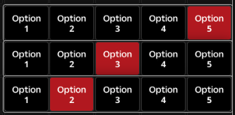

# Examples

## Radio Button Set with Section Variables

In this example, we use a section variable, an internal action, and the internal expression feedback to create a radio button set. Radio buttons are a set of buttons where only one button can be active at a time—a name given by the typical function on old radios where pressing one button would mechanically release any other selected button.

### Step 1: Create a Section with a Button



Start by making a section with a button inside.

### Step 2: Create a Section Variable



Select the Section and create a self variable inside it.

The full variable name will be `$(self.state.var_btn_nr)`

### Step 3: Add the Set Section Variable Action



Select the button and browse for the internal action **Set Section Variable**.



Configure the action with the variable you created earlier. Set the Value to **1**.

### Step 4: Add the Expression Feedback



Add the internal **Expression** feedback.



Configure the expression box with:

```
$(parent.state.var_btn_nr)== 1
```

> **Note:** The expression looks at the **Self variable** of the Parent object—in this case, the Section.

Configure the rest of the feedback as you wish with all options for content and styling.

### Step 5: Style the Button


Change the style of the button with a label and a number.

### Step 6: Copy the Buttons


Copy and paste the button so you have 5 buttons. Select the second button.

### Step 7: Update Each Button



For the second button, change:
- The number label to **2**
- The Action Value to **2**
- The number in the Expression to **2**



Repeat for buttons 3, 4, and 5.

### Result

You now have a set of 5 buttons with feedback that will only be "true" for one button at any given time. You can add actions like input selectors, folder navigation, or whatever else a radio button set would be useful for.



### Why Use Section Variables?

Since this radio button set uses a Section variable, the feedback is fully isolated to the section. You can copy the entire section and reuse it for other purposes. Even though the variable name is the same in every copy, they won't affect each other.

---

## Additional Examples

> More examples will be added to demonstrate:
> - Workflow variables for global state management
> - Encoder control patterns
> - Complex routing scenarios
> - Multi-position configurations

